# APB Decoder Design Specification

> **Scope of this document:** the APB-DEC-Generator tool and the APB decoder RTL (`m_vlsit_apbdec`) that it generates. Version 0.2 replaced the 0.1 behavior in which each slave window is a power-of-two block described by an offset and an address width. Version 0.3 adds the options Register Inputs and Register Outputs (flip-flops on all inputs and on all outputs, with the APB protocol correct in every combination), gates PENABLE of each slave with its own select, and fixes the common workbook format and the layout of the repository.
>
> Requirement terms: **shall** = mandatory and testable; **should** = recommended; **may** = optional. Every mandatory requirement has a REQ-<AREA>-<NNN> identifier and a verification method.

## Document map

1. [Purpose, scope, and product context](#1-purpose-scope-and-product-context)
2. [Normative references and precedence](#2-normative-references-and-precedence)
3. [Requirements and traceability](#3-requirements-and-traceability)
4. [Features and configurations](#4-features-and-configurations)
5. [Architecture](#5-architecture)
6. [External interfaces and ports](#6-external-interfaces-and-ports)
7. [Clock, reset, and power](#7-clock-reset-and-power)
8. [Parameters and elaboration configurations](#8-parameters-and-elaboration-configurations)
9. [Data representation and arithmetic](#9-data-representation-and-arithmetic)
10. [Detailed functional behavior](#10-detailed-functional-behavior)
11. [Register and programming model (CSR from workbook)](#11-register-and-programming-model)
12. [Error handling and recovery](#12-error-handling-and-recovery)
13. [Performance, power, and area](#13-performance-power-and-area)
14. [RTL implementation contract](#14-rtl-implementation-contract)
15. [Verification specification](#15-verification-specification)
16. [DFT and testability](#16-dft-and-testability)
17. [Physical design and timing integration](#17-physical-design-and-timing-integration)
18. [Security, safety, and reliability](#18-security-safety-and-reliability)
19. [Requirement-to-verification traceability](#19-requirement-to-verification-traceability)
20. [Assumptions, dependencies, and decisions](#20-assumptions-dependencies-and-decisions)
21. [Glossary](#21-glossary)
22. [References used to shape this template](#22-references-used-to-shape-this-template)

## 1. Purpose, scope, and product context

### 1.1 Purpose and scope

An AMBA APB system has one requester (an APB bridge) and several completers (peripherals). The APB decoder sits between them. It compares the byte address of each transfer with the address window of every peripheral, raises the select of the one peripheral that owns the address, forwards the transfer attributes, and returns that peripheral's response to the requester. Where no peripheral owns the address, the decoder answers the transfer itself.

The APB-DEC-Generator tool reads an Excel workbook and writes the decoder RTL, a JSON description of the resolved configuration, a self-checking testbench and the file lists. This revision changes three things compared with revision 0.1:

1. Every peripheral (slave interface) owns an arbitrary window, given by a start address and an end address (both inclusive, byte addresses). The size need not be a power of two and the start need not be aligned to the size.
2. The tool computes the width of the address port of every slave from its window. The user never enters an address width.
3. The response to an address that belongs to no slave is selected at run time by one input pin: an error response (PSLVERR = 1) or a plain ready response without error.

**Included:**

- The decoder module generated for one Excel configuration, with an APB4 requester-side (completer) port and one APB4 completer-side (requester) port per slave.
- The Excel schema, the validation and the computed values of the generator, the JSON file, the file lists, and the testbench generator with its bus functional models.
- The response of the decoder to a transfer to an unmapped address.
- The options Register Inputs and Register Outputs: flip-flops on every input and on every output of the decoder, chosen separately in the Excel file, with the clock and reset ports that they need.

**Excluded:**

- Software-visible registers: the decoder has none (section 11).
- Clock-domain crossing, wait-state insertion, registered pipeline stages and APB5 extensions (PWAKEUP, user signals, parity protection, PNSE).
- Access-permission checking: PPROT is forwarded and never evaluated by the decoder.
- Address translation other than the optional subtraction of the slave start address (the rebase).
- The peripherals themselves, the APB bridge and the system interconnect that drives the decoder.

### 1.2 Deployment assumptions

| Item | Specification |
|---|---|
| Target SoC / product class | Peripheral subsystem of a microcontroller-class SoC; the shipped example has 6 slaves on a 24-bit APB address bus. Assumption ASM-001. |
| Technology / library assumptions | Technology independent synthesizable RTL; no library cell is instantiated. |
| Operating modes and workload | One APB transfer at a time on the single requester port; pure combinational decode, so the decoder adds no wait state. |
| Security / privilege context | PPROT is forwarded unchanged to every slave; no access control is done in the decoder. |
| External dependencies | An APB4 requester that keeps PADDR, PPROT, PWRITE, PWDATA and PSTRB stable during a transfer (REF-001 section 4.1); slaves that comply with APB4; a source for the input pin `i_unmapped_err_en` (a strap, a register bit of the SoC, or a constant). |

### 1.3 Feature summary

| Feature ID | Feature | Required / optional | Configuration condition | Requirements |
|---|---|---|---|---|
| FEAT-001 | Arbitrary inclusive byte address window (start, end) per slave | Required | Always present | REQ-FUNC-001, REQ-GEN-001 |
| FEAT-002 | Automatic address width of every slave port from its window size | Required | Always present | REQ-FUNC-003, REQ-GEN-003 |
| FEAT-003 | Address rebase: slave sees the offset inside its window, or the raw low address bits | Optional | Excel option Address Rebase (default 1) | REQ-FUNC-004 |
| FEAT-004 | Response to an unmapped address selected by the input pin `i_unmapped_err_en` (error or ready only) | Required | Always present | REQ-FUNC-007, REQ-FUNC-008, REQ-ERR-001, REQ-ERR-002 |
| FEAT-005 | APB4 decode with forwarding of PPROT, PSTRB and write data, and response multiplexing | Required | Always present | REQ-IF-001, REQ-FUNC-002, REQ-FUNC-005, REQ-FUNC-006 |
| FEAT-006 | Generator validation of the memory map (overlap, range, names) and JSON output | Required | Always present | REQ-GEN-002, REQ-GEN-004, REQ-GEN-005 |
| FEAT-007 | Self-checking testbench generation for the configured memory map | Required | Always present | REQ-VER-001, REQ-VER-002 |
| FEAT-008 | Optional flip-flops on all inputs and on all outputs of the decoder (Register Inputs, Register Outputs), with the APB protocol correct in every combination | Optional | Excel options Register Inputs and Register Outputs (default 0 and 0) | REQ-FUNC-010 to REQ-FUNC-014, REQ-PERF-002, REQ-IF-004, REQ-RESET-001, REQ-GEN-009 |

### 1.4 Real-world applications of the features

The user answered "TBD" to the question about the real applications (2026-11-05). The rows below are therefore proposals taken from the example configuration that ships with the repository (`APB_DEC_Example.xlsx`: UART, I2C, SPI, CAN, PWM and GYRO slaves on a 24-bit bus) and from the bug report of the repository (`BUG_REPORT.md`: an independent 14-slave, 18-bit configuration). They are recorded as assumption ASM-001 in section 20 until the user confirms or replaces them.

| Feature ID | Real-world application (named system, example product) | What the application needs from the feature | Typical values | Consequence if missing or wrong | Requirements | Source |
|---|---|---|---|---|---|---|
| FEAT-001 | Peripheral bus of a microcontroller-class SoC that carries an I2C controller with a 24-byte register file and a 6 KB SRAM-like configuration window | Windows are packed back to back as the peripherals define them, without padding to a power of two | I2C window 0x100 to 0x117 (24 bytes); configuration window 0xC000 to 0xD7FF (6144 bytes) | A power-of-two-only decoder wastes address space or forces a window that is larger than the peripheral and aliases its registers | REQ-FUNC-001, REQ-GEN-001 | Assumption ASM-001; repository example |
| FEAT-002 | Same SoC; the integrator connects slave ports to peripherals whose register address ports have a fixed width | The slave address port is exactly wide enough for its window, so that no register is cut off and no unused bit is connected | 24 bytes need 5 bits; 6144 bytes need 13 bits; 1 byte needs 1 bit | A hand-entered width that is too small truncates the window and aliases registers; too large leaves floating or constant address bits | REQ-FUNC-003, REQ-GEN-003 | Assumption ASM-001; BUG_REPORT.md finding 5 |
| FEAT-003 | A reusable UART or SPI controller whose register map starts at address 0, placed at 0x1000 in the SoC | The peripheral sees offset 0 for the first byte of its window; when an upstream bridge already rebases the address, the option is switched off to avoid a second subtraction | SPI window 0x1000 to 0x1FFF seen as 0x000 to 0xFFF | The peripheral decodes wrong registers (for example CAN at 0x2000 would see 0x2000 instead of 0x0000) | REQ-FUNC-004 | Assumption ASM-001; BUG_REPORT.md finding 4 |
| FEAT-004 | Firmware bring-up of the SoC: with error enabled a stray pointer into a hole of the memory map raises a bus fault, in production the same hole may have to read as zero without a fault | One pin switches the response of every unmapped access at run time without regenerating the RTL | Unmapped transfer completes in 2 cycles (1 setup and 1 access, no wait state); pin 1 = error, pin 0 = ready only | A hole that silently returns zero hides software bugs during bring-up; a hole that always faults can break legacy firmware that probes the map | REQ-FUNC-007, REQ-FUNC-008, REQ-ERR-001, REQ-ERR-002 | Assumption ASM-001 |
| FEAT-005 | CPU of the SoC reaching peripherals through an APB bridge, with secure and non-secure software | Select, write data, byte strobes and protection attributes reach the selected peripheral unchanged, and its ready, data and error return to the CPU in the same cycle | 32-bit data, 4 strobes, PPROT 3 bits, 0 added wait states | An altered PSTRB or PPROT breaks byte writes or the secure-world check of the peripheral | REQ-IF-001, REQ-FUNC-002, REQ-FUNC-005, REQ-FUNC-006 | APB protocol REF-001 Table 2-1 and Table 3-2; assumption ASM-001 |
| FEAT-006 | Integration flow of an SoC with many peripherals, for example the 14-slave, 18-bit configuration of the bug report | A mistake in the Excel map (overlap, window outside the bus, bad name) stops the flow before any RTL is written | 14 slaves; 2 overlapping windows detected at generation time | Two select lines active together drive PRDATA from two slaves and corrupt reads | REQ-GEN-002, REQ-GEN-004, REQ-GEN-005 | BUG_REPORT.md findings 1, 2, 5; assumption ASM-001 |
| FEAT-007 | Regression of the memory map of the same SoC after each change of the Excel file | The testbench is regenerated from the same file and checks every window edge, the neighbors and the unmapped holes | 6 to 14 slaves; at least 8 checks per slave; both pin values | A moved window that is not re-verified makes one peripheral unreachable | REQ-VER-001, REQ-VER-002 | Assumption ASM-001 |
| FEAT-008 | The same SoC when its APB bridge, the decoder and the peripherals are placed far apart on a 200 MHz PCLK | The long path from the bridge address through the window compare and the slave-ready multiplexer back to the bridge is cut by flip-flops on the inputs, on the outputs, or on both | PCLK 100 MHz to 200 MHz; 2 extra cycles per transfer for one option, 4 for both; about 8 slaves | Without the option the decode path limits PCLK; a registered design that ignores the APB phases shows a slave an extra access cycle, so a write is repeated or a read side effect happens twice | REQ-FUNC-010 to REQ-FUNC-014, REQ-PERF-002 | User request 2026-11-05; assumption ASM-001 |

## 2. Normative references and precedence

### 2.1 Normative references

| Ref ID | Document and revision | Applicable clauses | Authority / notes |
|---|---|---|---|
| REF-001 | AMBA APB Protocol Specification, Arm IHI 0024 Issue D (ID041221), converted file `vlsit_apb_amba_apb_ihi0024d` | Section 2.1 (signals), 3.1 to 3.3 (transfers), 3.4 (error response), 3.5 (protection), 4.1 (operating states), A.1 (signal validity) | Protocol authority; APB4 profile |
| REF-002 | Repository documents of revision 0.1: `BUG_REPORT_rev0.1.md`, `src/apb_dec_rtl_generator.py`, `src/apb_dec_tb_generator.py`, the example workbook | All | Product behavior that this revision extends |
| REF-003 | VLSIT RTL Design Rules v2, VLSIT_RTL_Design_Rule.md | All applicable rules | Mandatory RTL coding, hierarchy, reset, CDC and naming baseline |
| REF-004 | IEEE 1800-2017 SystemVerilog | Synthesizable subset | Subject to REF-003 and the selected frontend |

### 2.2 Source-of-truth and conflict handling

1. REF-001 defines the protocol behavior of the APB4 profile used by this IP.
2. The decisions of section 20 define the product-specific behavior.
3. This specification defines the IP contract and shall remain consistent with REF-001 and REF-003.
4. REF-003 is the RTL coding, hierarchy, reset, CDC and naming baseline; a conflicting requirement is revised, not excepted.
5. The decoder has no register, so no CSR workbook exists (section 11).
6. The profile is APB4: PADDR, PPROT, PSEL, PENABLE, PWRITE, PWDATA, PSTRB, PREADY, PRDATA and PSLVERR. No signal of APB5 is present.
7. A conflict is resolved by an explicit product decision in section 20.

**Naming rule:** the default naming rule of the skill vlsit-rtl-generator, section 2 of VLSIT_RTL_Design_Rule.md v2, path `C:\Users\PC\.claude\skills\vlsit-asic-ip-microspec\reference\templates\VLSIT_RTL_Design_Rule.md` (copy of the rule file of the skill vlsit-rtl-generator), version v2, chosen by the user on 2026-11-05 (rule R-026). Where the rule requires a spelled-out word (NAM-08), the name uses it: the pin typed as `i_unmap_err_en` is named `i_unmapped_err_en` because "unmapped" is not in the abbreviation table.

### 2.3 Compliance declaration

| Standard | Revision / profile | Role implemented | Options | Deviations |
|---|---|---|---|---|
| AMBA APB | Issue D, APB4 | Completer on the requester-side port, requester on every slave-side port | PSLVERR, PSTRB and PPROT present; PWAKEUP, user signals and parity absent | None |
| IEEE 1800 | 2017, synthesizable subset | Generated RTL | None | None |

## 3. Requirements and traceability

| ID | Requirement using shall/should/may | Source | Applies to | Verification method |
|---|---|---|---|---|
| REQ-FUNC-001 | For every slave k with start address START_k and end address END_k, the decoder shall treat an address A as belonging to slave k when START_k is less than or equal to A and A is less than or equal to END_k, comparing all bits of i_paddr. START_k and END_k may be any byte addresses with START_k not greater than END_k; the window size may be any number of bytes. | REF-001 section 2.1.1; decision DEC-003 | All configurations | Simulation, formal equivalence with a reference model |
| REQ-FUNC-002 | The decoder shall drive o_psel_k high only when i_psel is high and A belongs to slave k. At most one o_psel_k shall be high at any time, and none shall be high for an unmapped address. | REF-001 section 2.1; DEC-007 | All configurations | Simulation, SVA, formal |
| REQ-FUNC-003 | The width of the address port o_paddr_k of slave k shall be W_k = max(1, clog2(END_k - START_k + 1)) bits, computed by the generator. | DEC-003 | All configurations | Generator test, lint |
| REQ-FUNC-004 | When Address Rebase is 1, o_paddr_k shall equal the low W_k bits of (i_paddr - START_k); the generated RTL may subtract the low W_k bits of START_k from the low W_k bits of i_paddr, which gives the same value modulo 2^W_k, and omits the subtraction when START_k is 0. When Address Rebase is 0, o_paddr_k shall equal the low W_k bits of i_paddr. | DEC-003 | CFG-EX, CFG-RAW | Simulation |
| REQ-FUNC-005 | The decoder shall drive o_pwrite_k, o_pwdata_k, o_pstrb_k and o_pprot_k of every slave with the value of i_pwrite, i_pwdata, i_pstrb and i_pprot of the transfer, whether or not that slave is selected, and o_penable_k with i_penable gated by the select of slave k, so that PENABLE is never high at a slave without its PSEL. With the register options the values are those of the transfer, delayed as REQ-PERF-002 states. | REF-001 section 4.1; DEC-006; DEC-013 | All configurations | Simulation, SVA, protocol checker |
| REQ-FUNC-006 | When A belongs to slave k, the decoder shall drive o_pready and o_prdata with i_pready_k and i_prdata_k, and o_pslverr with the logical AND of i_psel, i_penable, i_pready_k and i_pslverr_k. | REF-001 sections 3.4 and A.1; DEC-008 | All configurations | Simulation, SVA |
| REQ-FUNC-007 | When A belongs to no slave, the decoder shall drive o_pready high, o_prdata to zero, and o_pslverr with the logical AND of i_psel, i_penable and i_unmapped_err_en, and shall not raise any o_psel_k. | REF-001 section 3.4; DEC-004 | All configurations | Simulation, SVA |
| REQ-FUNC-008 | The input pin i_unmapped_err_en shall select the response of REQ-FUNC-007: value 1 gives an error response (PSLVERR high in the last cycle of the transfer), value 0 gives a ready response without error. The pin shall have no clock or reset, and its value shall be used as it is at the time of the access phase. | DEC-004 | All configurations | Simulation, SVA |
| REQ-FUNC-009 | When Register Inputs and Register Outputs are both 0, every output of the decoder shall be a combinational function of the inputs of the current cycle, and the decoder shall contain no flop and no latch and shall add no wait state. When an option is 1 the decoder shall contain flip-flops with asynchronous reset and no latch. | REQ-PERF-001; DEC-004; DEC-011 | All configurations | Lint, inspection, simulation |
| REQ-FUNC-010 | When Register Inputs is 1, the decoder shall register every input except the slave PREADY inputs and i_unmapped_err_en: i_paddr, i_pprot, i_psel, i_penable, i_pwrite, i_pwdata, i_pstrb and, for every slave, i_prdata_k and i_pslverr_k. When it is 0 none of these inputs shall be registered. | DEC-011; DEC-012 | CFG-REG-IN, CFG-REG-BOTH | Inspection, simulation |
| REQ-FUNC-011 | When Register Outputs is 1, the decoder shall register every output: o_psel_k, o_penable_k, o_pwrite_k, o_paddr_k, o_pwdata_k, o_pstrb_k and o_pprot_k of every slave, and o_pready, o_prdata and o_pslverr. When it is 0 none of these outputs shall be registered. | DEC-011 | CFG-REG-OUT, CFG-REG-BOTH | Inspection, simulation |
| REQ-FUNC-012 | In every combination of the two options the bus of every slave shall follow the APB4 protocol: a transfer to a slave consists of one setup cycle, then access cycles until the cycle where the slave asserts PREADY, then PSEL and PENABLE low in the next cycle; PENABLE of a slave is high only while its PSEL is high; at most one PSEL is high; the attributes are stable during the transfer; an unmapped address gives no slave transfer. | REF-001 sections 3 and 4.1; DEC-011 | CFG-REG-IN, CFG-REG-OUT, CFG-REG-BOTH | Protocol checker, scoreboard |
| REQ-FUNC-013 | In every combination the requester shall see PREADY low from its access phase until the response is available, then PREADY high in exactly one cycle per transfer, with o_prdata and o_pslverr valid in that cycle and o_pslverr low in every other cycle. | REF-001 sections 3.3, 3.4 and 4.1; DEC-011 | CFG-REG-IN, CFG-REG-OUT, CFG-REG-BOTH | Protocol checker, scoreboard |
| REQ-FUNC-014 | In every combination the decoder shall end the access phase of a slave in the cycle after the slave asserts its PREADY input: the slave PREADY inputs shall reach the end-of-access logic without a flip-flop. | REF-001 section 4.1; DEC-012 | CFG-REG-IN, CFG-REG-OUT, CFG-REG-BOTH | Protocol checker |
| REQ-IF-001 | The requester-side port and every slave-side port shall follow the APB4 profile of section 2.3; signals of APB5 shall not be present. | REF-001 section 2.1 | All configurations | Protocol checker, inspection |
| REQ-IF-002 | The address width AW shall be 1 to 32 bits, the data width DW shall be 8, 16 or 32 bits and the strobe width shall be DW divided by 8. | REF-001 Table 2-1 | All configurations | Generator test |
| REQ-IF-003 | The generator shall create one slave-side port group for every slave, named with the lower-case slave name as suffix: o_psel_k, o_penable_k, o_pwrite_k, o_paddr_k, o_pwdata_k, o_pstrb_k, o_pprot_k, i_pready_k, i_pslverr_k and i_prdata_k. | DEC-001, DEC-002 | All configurations | Generator test, lint |
| REQ-IF-004 | The decoder shall have the input ports i_clk_apb (clock, rising edge) and i_rst_n_apb (reset, active low, asynchronous assertion) when Register Inputs or Register Outputs is 1, and shall have neither when both are 0. | DEC-011; ASM-006 | All configurations | Generator test, lint |
| REQ-CLK-001 | The input pin i_unmapped_err_en shall be stable while i_psel is high. The integrator shall hold it constant for the duration of every transfer; a change while i_psel is low shall be allowed. | DEC-004 | All configurations | Inspection, SVA, SDC review |
| REQ-RESET-001 | When both options are 0 the decoder shall have no reset input, because it holds no state. When an option is 1, i_rst_n_apb shall reset every flip-flop to the idle state in which every select, PENABLE and PREADY is 0, and the decoder shall accept a new transfer after the release. | REQ-FUNC-009; DEC-011 | All configurations | Inspection, lint, simulation |
| REQ-GEN-001 | The generator shall read each slave from the columns NAME, START ADDRESS and END ADDRESS (hexadecimal text beginning with 0x), and the columns DESCRIPTION, SIZE and ADDRESS WIDTH may be present but shall not be used as inputs. | DEC-005 | All configurations | Generator test |
| REQ-GEN-002 | The generator shall stop with exit code 1, write no output file and print every problem when: a required field is missing; the sheet is missing; a START ADDRESS is greater than its END ADDRESS; an END ADDRESS exceeds 2^AW - 1; two windows overlap; a slave name is not a legal identifier, is longer than 18 characters, or collides with another name after conversion to lower case; the module name is not a legal identifier that starts with m_ and has at most 30 characters; Address Width is outside 1 to 32, Data Width is not 8, 16 or 32, or Write Strobe differs from Data Width / 8; or no slave is defined, or more than 64 are defined. | DEC-007; BUG_REPORT.md | All configurations | Generator test |
| REQ-GEN-003 | The generator shall compute SIZE = END - START + 1 and W_k in Python and shall not use any value that a spreadsheet formula has cached; a cached SIZE or ADDRESS WIDTH that differs from the computed value shall give a warning only. | DEC-003, DEC-005 | All configurations | Generator test |
| REQ-GEN-004 | When the slave table has an OFFSET or an ADDRESS WIDTH input column and no START ADDRESS column (the revision 0.1 schema), the generator shall stop with exit code 1 and an error that tells how to convert the file. A row "PSLVERR on Unmapped Access" in the master table shall be ignored with a warning, because the pin replaces it. | DEC-005 | All configurations | Generator test |
| REQ-GEN-005 | The generator shall write the resolved configuration to the JSON file with the fields json_version (2), module_name, address_width, data_width, write_strobe, address_rebase and, for every slave, name, start_val, end_val, size_bytes and address_width, and the testbench generator shall read only this file. | DEC-003 | All configurations | Generator test |
| REQ-GEN-006 | The generator shall print a warning, and still generate, when Address Rebase is 0 and a START ADDRESS is not a multiple of 2^W_k for that slave, because the raw low address bits then do not start at 0 in the slave. | DEC-003 | CFG-RAW | Generator test |
| REQ-GEN-007 | The generator shall write the file list with the decoder files, write the module name to the marker file `.module_name`, and shall derive every generated name from the validated lower-case slave name. | REF-002 | All configurations | Generator test |
| REQ-GEN-009 | The generator shall read the rows Register Inputs and Register Outputs of the Master Configuration table (0 or 1; 0 when a row is absent), reject any other value with an error, write them to the JSON file as register_inputs and register_outputs, and generate the clock and reset ports and the flip-flops only when an option is 1. | DEC-011 | All configurations | Generator test |
| REQ-GEN-008 | The workbooks that the repository delivers (the template and the examples) shall have the common format: the sheets GUIDELINE (first) and APB_DEC; a purple palette, the font Arial at size 13 in every cell, bold table titles and column headers (white text on purple), wrapped text, columns and rows wide and tall enough to show every text, and the description of the Config / Value / Description tables merged over several columns; the sheet GUIDELINE shall explain how to fill the workbook, every field, the rules and the register options. The generator shall read only the sheet APB_DEC and shall read a styled workbook exactly as an unstyled one. | User request 2026-11-05 | All configurations | Workbook style test, generator test |
| REQ-ERR-001 | An access to an unmapped address with i_unmapped_err_en = 1 shall complete in the first access cycle with o_pready = 1 and o_pslverr = 1. | REF-001 section 3.4 | All configurations | Simulation, SVA |
| REQ-ERR-002 | An access to an unmapped address with i_unmapped_err_en = 0 shall complete in the first access cycle with o_pready = 1, o_pslverr = 0 and o_prdata = 0, and no slave shall see a select. | REF-001 section 3.4 | All configurations | Simulation, SVA |
| REQ-ERR-003 | An error response of a selected slave shall reach o_pslverr in the same cycle, and the decoder shall not change o_prdata of that slave. | REF-001 section 3.4 | All configurations | Simulation |
| REQ-PERF-001 | The decoder shall add zero clock cycles of latency between a slave-side signal and the requester-side signal. | REQ-FUNC-009 | All configurations | Simulation |
| REQ-PERF-002 | With Register Inputs = a and Register Outputs = b (each 0 or 1) a transfer to an address that no slave owns shall take 2 + 2a + 2b cycles from its setup phase to the cycle of PREADY, that is 2, 4, 4 and 6 cycles; a mapped transfer shall take the same number of extra cycles on top of the wait states of the slave. | DEC-011 | All configurations | Scoreboard cycle count |
| REQ-RTL-001 | The generated RTL shall pass the rule check of the skill vlsit-rtl-generator without ERROR findings and shall be free of lint errors and latches. | REF-003 | All configurations | Rule check, lint |
| REQ-RTL-002 | The generator shall write the RTL as one module in one file `{module}.sv`, with no instance of another module, and shall list only that file in `filelist.f`. | DEC-010 | All configurations | Generator test, inspection |
| REQ-VER-001 | The generated testbench shall be self-checking, shall print the number of passed and failed checks, and shall end with a failing exit code when any check fails. | DEC-009 | All configurations | Generator test |
| REQ-VER-002 | For every slave the generated testbench shall check the first and the last address of its window, the address just below the start and just above the end, the local address seen by the slave, a write and a read back, and shall run the unmapped checks with i_unmapped_err_en equal to 1 and equal to 0. | DEC-009 | All configurations | Simulation |
| REQ-VER-003 | In every configuration the generated testbench shall check the APB protocol on the requester bus and on the bus of every slave with a protocol checker, shall check every requester transfer against the reference model with a scoreboard (one slave access at the owner, none for a hole, attributes, local address, response and number of cycles), and shall drive the clock and the reset when an option is 1. | DEC-011 | All configurations | Simulation, mutation |

Suggested ID areas in use: FUNC, IF, CLK, RESET, GEN, ERR, PERF, RTL, VER.

## 4. Features and configurations

| Configuration ID | Enabled features | Disabled features | Interfaces / widths | Intended use | Verification target |
|---|---|---|---|---|---|
| CFG-EX | FEAT-001 to FEAT-007, Address Rebase = 1 | None | AW 24, DW 32, STRB 4, 8 slaves (table in section 9) | Shipped example: power-of-two and non-power-of-two windows | Every REQ |
| CFG-RAW | As CFG-EX, Address Rebase = 0 | FEAT-003 rebase | Same as CFG-EX | System whose upstream stage already rebases the address | REQ-FUNC-004, REQ-GEN-006 |
| CFG-MIN | FEAT-001, FEAT-002, FEAT-004, FEAT-005 | None | AW 1, DW 8, STRB 1, one slave of 1 byte | Smallest legal map | Boundary of REQ-FUNC-003 and REQ-IF-002 |
| CFG-MAX | FEAT-001 to FEAT-007 | None | AW 32, DW 32, STRB 4, 64 slaves | Largest map that the generator accepts (ASM-002) | Generator limits, lint, simulation time |
| CFG-REG-IN | FEAT-001 to FEAT-008, Register Inputs = 1 | None | AW 16, DW 32, STRB 4, 3 slaves, ports i_clk_apb and i_rst_n_apb | Input flip-flops for timing closure | REQ-FUNC-010, REQ-FUNC-012 to REQ-FUNC-014, REQ-PERF-002 |
| CFG-REG-OUT | FEAT-001 to FEAT-008, Register Outputs = 1 | None | Same | Output flip-flops | REQ-FUNC-011, REQ-FUNC-012 to REQ-FUNC-014, REQ-PERF-002 |
| CFG-REG-BOTH | FEAT-001 to FEAT-008, both options = 1 | None | Same | Input and output flip-flops | Every requirement of the two lines above |

Register Inputs and Register Outputs are generation-time options: with an option on the generated RTL is clocked (ports i_clk_apb and i_rst_n_apb) and contains the flip-flops of that option; with both off it is the combinational decoder of revision 0.2. The four combinations are all legal.

Address Rebase is a generation-time option: the generated RTL contains either the subtraction or the plain truncation, never both. The unmapped response is a run-time option: the pin exists in every configuration and is not removable. There are no illegal combinations other than those that REQ-GEN-002 rejects; the generator reports each one and writes nothing.

## 5. Architecture

### 5.1 Overview and block responsibilities

The decoder is one combinational module in one file. Inside it the logic has three parts that are not separate modules: the window match, the local address and the response selection. The window match compares the address with the N windows and produces one select per slave and an unmapped flag. The local address part gives every slave its address. The response part selects the slave response or builds the unmapped response. The attributes that do not depend on the selection are forwarded by plain wires.

| Block | Responsibility | Inputs / outputs | Clock/reset domain | State or storage |
|---|---|---|---|---|
| m_vlsit_apbdec | The whole decoder: window match, gating of the select with i_psel, unmapped flag, local address of every slave, response selection, forwarding of the other attributes; with an option on also the input stage, the output stage and the phase state machine | Requester side and slave side ports of section 6.2, i_unmapped_err_en, i_clk_apb and i_rst_n_apb with an option | CLK-APB with an option, none without | None without options; with options the flip-flops of the stages and two phase flip-flops |

With Register Inputs = 1 an input stage registers the requester signals and the slave read data and error. With Register Outputs = 1 an output stage registers every output. As soon as an option is on, a small state machine produces the phases of the slave side and the PREADY of the requester, so that the APB protocol holds on every bus in every combination: a trigger (the requester setup phase is seen and the decoder is idle) starts a transfer; the slave side shows one setup cycle, then access cycles until the PREADY pin of the selected slave (at once for an unmapped address); one response pulse per transfer returns PREADY, read data and error to the requester after the stages of the options. The PREADY pins of the slaves are not registered for the end of the access, because the slave must see its transfer end in the cycle after it asserts PREADY (decision DEC-012).

### 5.2 Block diagram

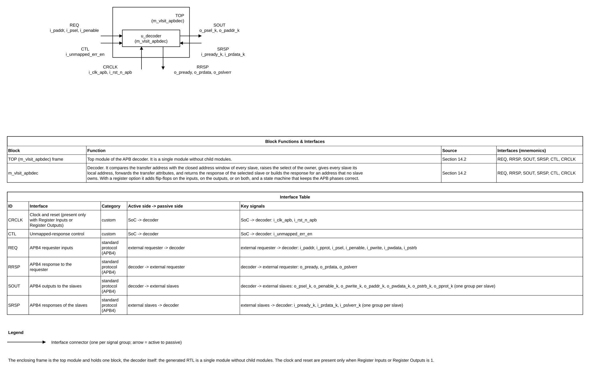

*Figure 5-1. Block diagram of m_vlsit_apbdec. Source: `figures/block_diagram.drawio` (draw.io, VLSIT library, drawn by `vlsit_spec_diagram.py`). The frame is the top module, the blocks are its instances, each connector is one interface with its mnemonic, and the two tables under the diagram in the source file describe the blocks and the interfaces.*

### 5.3 Transaction and dataflow

A transfer starts when the requester drives i_psel high with i_penable low (setup cycle). In the same cycle the window match selects the slave, the local address of that slave shows the offset or the raw low address bits, and the selected slave sees o_psel_k high with o_penable_k low. In the next cycle (access) i_penable is high and the slave answers with i_pready_k, i_prdata_k and i_pslverr_k, which the response part returns without delay. If the slave holds i_pready_k low, the access cycle repeats with the same address and attributes (REF-001 section 4.1). For an unmapped address no slave sees a select, and the response part returns the ready response of REQ-FUNC-007 in the first access cycle.

With an option on the requester sees extra wait states: its access phase starts one cycle after its setup phase as usual, but PREADY stays low until the response comes back, 2 cycles later per option than without options (REQ-PERF-002). The slave sees a normal transfer that starts later. The decoder handles one transfer at a time: the requester cannot start the next transfer before it received PREADY, and by then the slave side is idle.

### 5.4 Invariants

- INV-001: at most one o_psel_k is high at any time (REQ-FUNC-002).
- INV-002: when no window contains the address, all o_psel_k are low and o_pready is high (REQ-FUNC-007).
- INV-003: o_pslverr is low whenever i_psel, i_penable or o_pready is low (REF-001 section 3.4 recommendation).
- INV-004: windows are disjoint and lie inside 0 to 2^AW - 1; this is checked by the generator, not at run time (REQ-GEN-002).
- INV-005: with both options 0 the decoder holds no state: with the same inputs the outputs are the same.
- INV-006: with an option on, a new transfer is triggered only when the decoder is idle, and the requester starts the next transfer only after the PREADY of the previous one.
- INV-007: a slave never sees an access cycle after the cycle where it asserted PREADY (REQ-FUNC-014).
- INV-008: the requester sees PREADY high in exactly one cycle per transfer (REQ-FUNC-013).

## 6. External interfaces and ports

### 6.1 Interface inventory

| Interface ID | Type and revision | Role | Direction at IP boundary | Clock domain | Required / optional | Configurations |
|---|---|---|---|---|---|---|
| IF-001 | AMBA APB4 (Issue D) | Completer (the decoder answers the requester) | Inputs i_p*, outputs o_pready, o_prdata, o_pslverr | CLK-APB | Required | All |
| IF-002 | AMBA APB4 (Issue D) | Requester, one instance per slave | Outputs o_p*_k, inputs i_p*_k | CLK-APB | Required, at least 1 and at most 64 | All |
| IF-003 | Static control pin | Selects the unmapped response | Input i_unmapped_err_en | CLK-APB | Required | All |
| IF-004 | Clock and reset | Clock and asynchronous reset of the flip-flops | Inputs i_clk_apb, i_rst_n_apb | CLK-APB | Present only when Register Inputs or Register Outputs is 1 | CFG-REG-IN, CFG-REG-OUT, CFG-REG-BOTH |

### 6.2 Complete port list

The decoder has no test or interrupt port. It has a clock and a reset port (the first two rows) only when Register Inputs or Register Outputs is 1. The widths AW, DW and STRB (= DW / 8) come from the Excel master configuration. The slave-side rows are shown for the slave named UART of configuration CFG-EX (window 0x0000 to 0x00FF, W = 8); the same group of ten ports exists for every slave, with the lower-case slave name as suffix, and the width of o_paddr_k is W_k of that slave. The longest slave name is 18 characters so that every name is at most 30 characters (NAM-07).

| Port | Direction | Width | Meaning (function) | Clock domain | Signal type | Reset / idle value | Timing / sampling | Configurations |
|---|---|---:|---|---|---|---|---|---|
| i_clk_apb | Input | 1 | Clock of the flip-flops; present only when Register Inputs or Register Outputs is 1 | CLK-APB | Clock | Running | Rising edge | CFG-REG-IN, CFG-REG-OUT, CFG-REG-BOTH |
| i_rst_n_apb | Input | 1 | Asynchronous reset, active low, of the flip-flops; present only when Register Inputs or Register Outputs is 1 | CLK-APB | Reset (asynchronous assertion, active low) | Asserted at power-up | Release by the integrator, synchronous to i_clk_apb | CFG-REG-IN, CFG-REG-OUT, CFG-REG-BOTH |
| i_paddr | Input | AW | Byte address of the transfer from the requester | CLK-APB (no port) | Data (valid with i_psel) | Any when i_psel is low | Stable from setup to the end of access | All |
| i_pprot | Input | 3 | Protection attributes, forwarded to every slave | CLK-APB (no port) | Data (valid with i_psel) | Any when i_psel is low | Stable during the transfer | All |
| i_psel | Input | 1 | Requester select; gates every o_psel_k | CLK-APB (no port) | Level (high for the setup and access cycles of a transfer) | 0 | Sampled by the slave at the rising edge of PCLK | All |
| i_penable | Input | 1 | Access-phase indication of the requester; it gates o_penable_k | CLK-APB (no port) | Level (high in the access cycles) | 0 | Sampled by the slave at the rising edge of PCLK | All |
| i_pwrite | Input | 1 | Direction: 1 = write, 0 = read | CLK-APB (no port) | Data (valid with i_psel) | Any when i_psel is low | Stable during the transfer | All |
| i_pwdata | Input | DW | Write data, forwarded to every slave | CLK-APB (no port) | Data (valid with i_psel and i_pwrite) | Any | Stable during the transfer | All |
| i_pstrb | Input | STRB | Write byte strobes; all zero for a read (REF-001 section 3.2) | CLK-APB (no port) | Data (valid with i_psel) | Any when i_psel is low | Stable during the transfer | All |
| o_pready | Output | 1 | Transfer completion; slave ready for a mapped address, 1 for an unmapped address | CLK-APB (no port) | Level (valid with i_psel and i_penable) | 1 for an idle bus with an unmapped address | Combinational, same cycle as the slave (both options 0); after the stages of the options otherwise | All |
| o_prdata | Output | DW | Read data of the selected slave, 0 for an unmapped address | CLK-APB (no port) | Data (valid with o_pready, i_psel, i_penable and a read) | 0 for an unmapped address | Combinational | All |
| o_pslverr | Output | 1 | Transfer error: slave error or unmapped error | CLK-APB (no port) | Level (valid with i_psel, i_penable and o_pready) | 0 | Low unless i_psel, i_penable and o_pready are high (combinational with both options 0, with the response pulse otherwise) | All |
| i_unmapped_err_en | Input | 1 | Selects the response to an unmapped address: 1 = error (PSLVERR), 0 = ready only | CLK-APB (no port) | Static (constant while i_psel is high; may change while i_psel is low) | Integrator choice; 1 when tied for the safe behavior (DEC-004) | Used combinationally; constrained as a quasi-static input (section 17) | All |
| o_psel_uart | Output | 1 | Select of slave UART: i_psel and the address is inside its window | CLK-APB (no port) | Level (high in the setup and access cycles of a transfer to this slave) | 0 | Combinational | All |
| o_penable_uart | Output | 1 | PENABLE of the slave: i_penable gated with the select of this slave, high in the access cycles of a transfer to this slave only | CLK-APB (no port) | Level (same as i_penable) | 0 | Combinational | All |
| o_pwrite_uart | Output | 1 | Copy of i_pwrite for the slave | CLK-APB (no port) | Data (valid with o_psel_uart) | Any | Combinational | All |
| o_paddr_uart | Output | W (8 here) | Local address of the slave: offset inside the window (rebase on) or low address bits (rebase off) | CLK-APB (no port) | Data (valid with o_psel_uart) | Any | Combinational | All |
| o_pwdata_uart | Output | DW | Copy of i_pwdata for the slave | CLK-APB (no port) | Data (valid with o_psel_uart and a write) | Any | Combinational | All |
| o_pstrb_uart | Output | STRB | Copy of i_pstrb for the slave | CLK-APB (no port) | Data (valid with o_psel_uart) | Any | Combinational | All |
| o_pprot_uart | Output | 3 | Copy of i_pprot for the slave | CLK-APB (no port) | Data (valid with o_psel_uart) | Any | Combinational | All |
| i_pready_uart | Input | 1 | Ready of the slave | CLK-APB (no port) | Level (valid with o_psel_uart and o_penable_uart) | 1 when not selected is allowed | Sampled by the requester at the rising edge of PCLK | All |
| i_pslverr_uart | Input | 1 | Error of the slave | CLK-APB (no port) | Level (valid with o_psel_uart, o_penable_uart and i_pready_uart) | 0 | Sampled by the requester | All |
| i_prdata_uart | Input | DW | Read data of the slave | CLK-APB (no port) | Data (valid with i_pready_uart in a read) | Any | Sampled by the requester | All |

### 6.3 Protocol behavior

The decoder implements the APB4 profile of REF-001 on both sides. It does not insert wait states, so a slave that holds PREADY low stretches the transfer on the requester side as well (REF-001 section 4.1).

| Case | Legal behavior | Illegal / unsupported case | IP response | Requirement IDs |
|---|---|---|---|---|
| Mapped transfer, no wait | Setup then access; slave answers in the first access cycle | None | Slave signals returned in the same cycle | REQ-FUNC-006 |
| Mapped transfer with wait states | i_pready_k low for n cycles | None | o_pready low for the same n cycles; o_pslverr low | REQ-FUNC-006 |
| Mapped transfer, slave error | i_pslverr_k high with i_pready_k in the last cycle | None | o_pslverr high in that cycle | REQ-FUNC-006, REQ-ERR-003 |
| Unmapped transfer, pin = 1 | PSEL and PENABLE high | None | o_pready 1, o_pslverr 1, o_prdata 0, no o_psel_k | REQ-FUNC-007, REQ-ERR-001 |
| Unmapped transfer, pin = 0 | PSEL and PENABLE high | None | o_pready 1, o_pslverr 0, o_prdata 0, no o_psel_k | REQ-FUNC-007, REQ-ERR-002 |
| Address not aligned to the data width | Allowed by REF-001 section 2.1.1 (result UNPREDICTABLE) | None | Decoded by byte address like any other; the slave decides | REQ-FUNC-001 |
| Idle bus (i_psel low) | Any PADDR | None | All o_psel_k low; o_pslverr low; o_pready not used by the requester | REQ-FUNC-002, INV-003 |
| Address changes during a transfer | None | Requester breaks REF-001 section 4.1 | Not defined; the decoder follows the new address | REQ-FUNC-001 |
| i_unmapped_err_en changes while i_psel is high | None | Integration violation | The response of that transfer is not defined; no hang because o_pready stays 1 | REQ-CLK-001 |
| Register option on, mapped transfer | Setup and access phases at the requester | None | The slave sees one setup cycle and then access cycles until its PREADY; the requester sees PREADY low until the response is back, then one PREADY cycle | REQ-FUNC-012, REQ-FUNC-013 |
| Register option on, slave wait states | The slave holds PREADY low | None | The access cycles repeat at the slave; the requester waits | REQ-FUNC-012, REQ-FUNC-014 |
| Reset asserted during a transfer | Not defined by REF-001 | The requester and the decoder are reset together | Every flip-flop returns to idle; no PREADY is returned for that transfer | REQ-RESET-001 |

### 6.4 Interrupts and events

N/A: the decoder has no interrupt or event output.

## 7. Clock, reset, and power

### 7.1 Clock domains

| Domain | Clock port | Edge | Frequency range | Source | Relationship to other clocks | Gating policy |
|---|---|---|---|---|---|---|
| CLK-APB | i_clk_apb when Register Inputs or Register Outputs is 1; none otherwise (the decoder is then timed against PCLK of the interconnect) | Rising | Set by the SoC | APB bridge clock (PCLK) | One domain | None; no clock gating |

### 7.2 CDC and RDC

There is no clock-domain crossing and no reset-domain crossing, because the decoder has no flop and a single APB domain. The pin i_unmapped_err_en must come from the CLK-APB domain or from a static source; if it comes from another domain the integrator synchronizes it before the pin (REQ-CLK-001).

| Crossing ID | From → to | Signals | Structure | Reset handling | Constraints / verification |
|---|---|---|---|---|---|
| CDC-001 | N/A: none in this IP | None | None | None | Not applicable; the pin is covered by REQ-CLK-001 |

### 7.3 Reset domains and sequencing

| Reset ID | Port | Polarity / assertion | Sync or async | Scope | Deassertion | Reset value |
|---|---|---|---|---|---|---|
| RST-APB | i_rst_n_apb (only with an option; with both options 0 the decoder has no state and no reset) | Active low | Asynchronous assertion; release by the integrator synchronous to i_clk_apb | Every flip-flop of the decoder | Release synchronous to i_clk_apb | Idle: every select, PENABLE and PREADY is 0 |

With both options 0 the decoder follows its inputs and keeps no memory of a transfer. With an option on, the asynchronous reset returns every flip-flop to the idle state; the requester is reset in the same event, and a transfer that was in progress is abandoned (REQ-RESET-001, ERR-006).

### 7.4 Power intent (if applicable)

N/A: the decoder is part of one power domain with the interconnect; it has no isolation, retention or clock-stop behavior of its own.

## 8. Parameters and elaboration configurations

The generated RTL has no overridable parameter: its port widths and ranges are fixed when the generator writes it, because the number of slaves and the width of each slave port change the port list (REF-003 PRT-03). The generator inputs that define a configuration are listed below. Each slave window is written into the RTL as two derived constants (REF-003 PAR-01) of the form `localparam logic [31:0] LPARA_{SLAVE}_START` and `LPARA_{SLAVE}_END`, and the width of every slave port as `LPARA_{SLAVE}_W`, where {SLAVE} is the upper-case slave name; the name of each is at most 30 characters.

| Parameter | Purpose | Default | Legal values / range | Dependencies / invalid combinations | Effect |
|---|---|---|---|---|---|
| Module Name (Excel) | Name of the generated top module | m_vlsit_apbdec | Legal identifier that starts with m_, at most 30 characters (NAM-07) | None | Names the files and the JSON |
| Address Width AW (Excel) | Width of i_paddr | 24 in the example | 1 to 32 | Every END must be at most 2^AW - 1 | Width of i_paddr and of the compare |
| Data Width DW (Excel) | Width of the data buses | 32 | 8, 16 or 32 | STRB = DW / 8 | Width of i_pwdata, o_prdata and the slave data ports |
| Write Strobe (Excel) | Width of the strobe buses; the row may be omitted | DW / 8 | Must equal DW / 8 | A different value is an error | Width of i_pstrb and o_pstrb_k |
| Address Rebase (Excel) | Rebase on or off | 1 | 0 or 1 | With 0 and an unaligned START the generator warns (REQ-GEN-006) | Selects REQ-FUNC-004 form |
| Register Inputs (Excel) | Flip-flops on the inputs | 0 | 0 or 1 | 1 adds i_clk_apb and i_rst_n_apb | +2 cycles per transfer; flip-flops on every input except the slave PREADY inputs and the pin |
| Register Outputs (Excel) | Flip-flops on the outputs | 0 | 0 or 1 | 1 adds i_clk_apb and i_rst_n_apb | +2 cycles per transfer; flip-flops on every output |
| Workbook format | Look of the example workbooks | Purple, Arial 13 | Not read by the generator | None | REQ-GEN-008 |
| Slave NAME | Name of a slave and the suffix of its ports | None | 1 to 18 characters, letters, digits and underscore, not starting with a digit, unique after conversion to lower case | At least 1 and at most 64 slaves | Names every port, constant and signal of the slave |
| START ADDRESS | First byte of the window | None | 0x0 to END ADDRESS | Windows must not overlap | Value of LPARA_..._START |
| END ADDRESS | Last byte of the window (inclusive) | None | START ADDRESS to 2^AW - 1 | Windows must not overlap | Value of LPARA_..._END; W_k |

| Configuration | Parameter overrides | Features/interfaces | Expected hierarchy | Elaboration/lint/synthesis target |
|---|---|---|---|---|
| CFG-EX | Excel example of section 9 | All | One module | Lint and synthesis of the generated files |
| CFG-RAW | Address Rebase = 0 | All but rebase | Same | Same |
| CFG-MIN / CFG-MAX | Limits of section 4 | All | Same | Lint only |
| CFG-REG-IN / CFG-REG-OUT / CFG-REG-BOTH | Register Inputs and Register Outputs as named | All | One module | Lint and simulation of the generated file |

The behavior for an illegal configuration is fixed by REQ-GEN-002: no file is written, so no illegal RTL can reach elaboration.

## 9. Data representation and arithmetic

All addresses are unsigned byte addresses. Windows are closed intervals: START and END both belong to the window. SIZE = END - START + 1, computed in the generator with arbitrary precision (Python integers), so SIZE can be up to 2^32. W = max(1, clog2(SIZE)), where clog2(n) is the smallest integer m with 2^m at least n; therefore a window of 1 byte has W = 1, 24 bytes has W = 5, and 6144 bytes has W = 13.

Rebase: o_paddr_k = (i_paddr - START_k) taken modulo 2^AW, then the low W_k bits. Because START_k is at most i_paddr when the slave is selected, the difference is never negative and is at most SIZE - 1, so it fits in W_k bits. Without rebase: the low W_k bits of i_paddr, which are distinct for every address of the window because the window is not larger than 2^W_k.

Example configuration CFG-EX (AW 24, DW 32, Address Rebase 1):

| Slave | START | END | SIZE (bytes) | W | o_paddr range seen by the slave |
|---|---|---|---:|---:|---|
| UART | 0x000000 | 0x0000FF | 256 | 8 | 0x00 to 0xFF |
| I2C | 0x000100 | 0x000117 | 24 | 5 | 0x00 to 0x17 |
| SPI | 0x001000 | 0x001FFF | 4096 | 12 | 0x000 to 0xFFF |
| CAN | 0x002000 | 0x009FFF | 32768 | 15 | 0x0000 to 0x7FFF |
| PWM | 0x00A000 | 0x00A0FF | 256 | 8 | 0x00 to 0xFF |
| GYRO | 0x00B000 | 0x00B3FF | 1024 | 10 | 0x000 to 0x3FF |
| SRAMCSR | 0x00C000 | 0x00D7FF | 6144 | 13 | 0x0000 to 0x17FF |
| ROMTAB | 0x00E010 | 0x00E02F | 32 | 5 | 0x00 to 0x1F |

The windows I2C (24 bytes), SRAMCSR (6144 bytes) and ROMTAB (32 bytes) are not powers of two or are not aligned to their size. ROMTAB has a start (0xE010) that is not a multiple of its size (32): with Address Rebase 0 the generator warns (REQ-GEN-006), because the raw low 5 bits start at 0x10, not 0.

Worked examples of the address that a slave sees in CFG-EX (W is the width of the slave address port; the offset is i_paddr - START; both columns are cut to W bits):

| Slave | i_paddr | START | W | o_paddr_k, Address Rebase = 1 | o_paddr_k, Address Rebase = 0 | Remark |
|---|---|---|---:|---|---|---|
| UART | 0x000080 | 0x000000 | 8 | 0x80 | 0x80 | START is 0: both settings give the same value |
| I2C | 0x000117 | 0x000100 | 5 | 0x17 | 0x17 | START is a multiple of 2^5, so the low 5 bits already equal the offset |
| SPI | 0x001234 | 0x001000 | 12 | 0x234 | 0x234 | START is a multiple of 2^12 |
| CAN | 0x002000 | 0x002000 | 15 | 0x0000 | 0x2000 | First byte of the window: the slave sees 0 with rebase, 0x2000 without |
| CAN | 0x003456 | 0x002000 | 15 | 0x1456 | 0x3456 | START 0x2000 is not a multiple of 2^15 (0x8000): the values differ |
| CAN | 0x009FFF | 0x002000 | 15 | 0x7FFF | 0x1FFF | Last byte: without rebase the 15 raw bits wrapped (0x2000 to 0x7FFF, then 0x0000 to 0x1FFF), still distinct for every byte of the window |
| PWM | 0x00A0F0 | 0x00A000 | 8 | 0xF0 | 0xF0 | START is a multiple of 2^8 |
| GYRO | 0x00B3FF | 0x00B000 | 10 | 0x3FF | 0x3FF | START is a multiple of 2^10 |
| SRAMCSR | 0x00D7FF | 0x00C000 | 13 | 0x17FF | 0x17FF | 6144 bytes, W = 13; START is a multiple of 2^13 (0xC000 = 6 x 0x2000) |
| ROMTAB | 0x00E010 | 0x00E010 | 5 | 0x00 | 0x10 | First byte: 0 with rebase, 0x10 without (REQ-GEN-006 warns) |
| ROMTAB | 0x00E014 | 0x00E010 | 5 | 0x04 | 0x14 | The address of waveforms WF-014 to WF-017 |
| ROMTAB | 0x00E02F | 0x00E010 | 5 | 0x1F | 0x0F | Last byte: without rebase the raw bits wrapped from 0x1F to 0x00 inside the window |

Rule of thumb: the two settings give the same value for a slave exactly when START is a multiple of 2^W (the slave window is aligned to its own size, as in the first half of the table); otherwise only Address Rebase = 1 gives a slave address that starts at 0 and is continuous.

Unmapped addresses of CFG-EX are 0x000118 to 0x000FFF, 0x00A100 to 0x00AFFF, 0x00B400 to 0x00BFFF, 0x00D800 to 0x00E00F, 0x00E030 to 0xFFFFFF.

| Quantity | Width | Encoding / range | Extension / truncation | Overflow / invalid behavior |
|---|---:|---|---|---|
| i_paddr | AW | Unsigned byte address | Compared at full width with constants of the same width | None |
| START, END (constants) | AW | Unsigned | Written as AW-bit hexadecimal literals | END above 2^AW - 1 is rejected by the generator |
| o_paddr_k | W_k | Unsigned offset or raw low bits | Subtraction at AW bits, then the low W_k bits | Cannot overflow for a selected slave (see above) |
| Select vector | N | One-hot or all zero | None | More than one bit is impossible after REQ-GEN-002 |
| i_unmapped_err_en | 1 | 1 = error, 0 = ready only | None | X is a user error; the response is X |

## 10. Detailed functional behavior

### 10.1 Modes and state transitions

The decoder has no state. The only mode is the value of the pin i_unmapped_err_en; the APB bus states (IDLE, SETUP, ACCESS) belong to the requester and the slaves (REF-001 section 4.1) and are decoded here only through i_psel and i_penable.

| Mode/state | Entry condition | Behavior | Exit condition | Outputs / side effects |
|---|---|---|---|---|
| Unmapped error | i_unmapped_err_en = 1 | Unmapped access gives PSLVERR | Pin goes to 0 while i_psel is low | o_pslverr high in the access cycle of an unmapped transfer |
| Unmapped ready only | i_unmapped_err_en = 0 | Unmapped access gives ready only | Pin goes to 1 while i_psel is low | o_pslverr low, o_pready high, o_prdata 0 |
| Idle (an option on) | Reset released, or the end of a transfer | No select, PREADY 0 | The requester setup phase is seen | All outputs idle |
| Setup at the slave (an option on) | Trigger | One setup cycle at the owner of the address | Next cycle | PSEL of the owner high, PENABLE low |
| Access at the slave (an option on) | After the setup cycle | Access cycles until PREADY of the owner (one cycle for an unmapped address) | PREADY seen | PSEL and PENABLE of the owner high |

### 10.2 Operations

| Operation ID | Inputs / preconditions | Processing semantics | Result / completion | Latency / ordering |
|---|---|---|---|---|
| OP-001 | i_paddr, i_psel | Compare i_paddr with every window; raise o_psel_k for the match when i_psel is high | One-hot select or none | 0 cycles, combinational |
| OP-002 | A mapped transfer (setup, then access) | Forward attributes and the local address; return pready, prdata and pslverr of the slave | Transfer ends when the slave raises i_pready_k | 0 added cycles; ordering is the order of the requester |
| OP-003 | An unmapped transfer with i_unmapped_err_en = 1 | No select; o_pready = 1, o_prdata = 0, o_pslverr = 1 in the access cycle | Completes with an error in the first access cycle | 0 added cycles |
| OP-004 | An unmapped transfer with i_unmapped_err_en = 0 | No select; o_pready = 1, o_prdata = 0, o_pslverr = 0 | Completes without error in the first access cycle | 0 added cycles |
| OP-005 | The window of a non-power-of-two or unaligned slave | Subtract START (rebase on) or truncate (rebase off) and cut to W_k bits | o_paddr_k shows the offset or the raw low bits | 0 cycles |
| OP-006 | A transfer with Register Inputs or Register Outputs on; the decoder is idle | Trigger on the requester setup phase, setup cycle and access cycles at the owner until its PREADY pin, response pulse delayed by the stages of the options | PREADY for one cycle with read data and error | 2a + 2b cycles longer than without options (a, b = the options); one transfer at a time |

The generator step (validation, computation of SIZE and W_k, writing of the files) is a tool flow, not an interface operation; it is specified by REQ-GEN-001 to REQ-GEN-007 and checked by TEST-009 and TEST-010.

### 10.3 Cycle-level behavior

**Waveform plan (rule R-024).** The user confirmed the complete list WF-001 to WF-008 on 2026-11-05 (option A). Each figure has its WaveJSON source beside it in the folder `figures`.

| Waveform ID | Function / operation | Scenario (success / error / corner) | Signals shown | Figure | Confirmed by user |
|---|---|---|---|---|---|
| WF-001 | OP-002 mapped write with no wait state | success | PCLK, i_paddr, i_psel, i_penable, i_pwrite, i_pwdata, o_psel_k, o_paddr_k, o_pwdata_k, o_pready, o_pslverr | 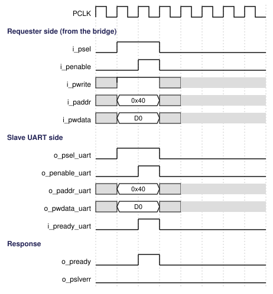 | 2026-11-05 |
| WF-002 | OP-002 mapped read with wait states from the slave | success | PCLK, i_psel, i_penable, o_psel_k, i_pready_k, i_prdata_k, o_pready, o_prdata | 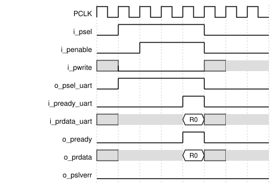 | 2026-11-05 |
| WF-003 | OP-002 mapped transfer that ends with a slave error | error | i_pready_k, i_pslverr_k, o_pready, o_pslverr | 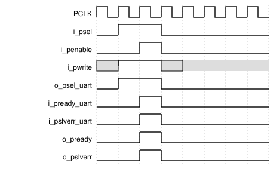 | 2026-11-05 |
| WF-004 | OP-003 unmapped access with i_unmapped_err_en = 1 | error | i_paddr, i_psel, i_penable, i_unmapped_err_en, o_psel_k, o_pready, o_prdata, o_pslverr | 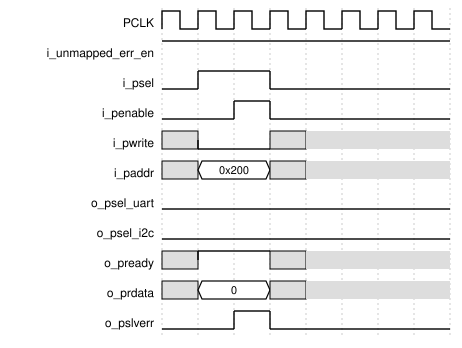 | 2026-11-05 |
| WF-005 | OP-004 unmapped access with i_unmapped_err_en = 0 | success | Same as WF-004 | 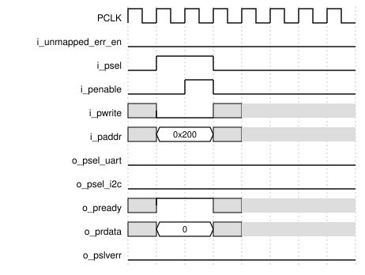 | 2026-11-05 |
| WF-006 | OP-001 and OP-005 boundary: last address of a window, then the next address, back to back | corner | i_paddr, o_psel_k, o_paddr_k, o_pready, o_pslverr | 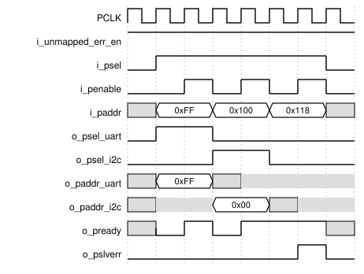 | 2026-11-05 |
| WF-007 | OP-005 slave with a window of 24 bytes (W = 5) and an unaligned start, rebase on and off | corner | i_paddr, o_paddr_k for both settings | 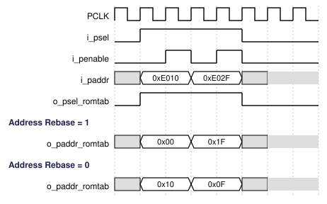 | 2026-11-05 |
| WF-008 | Idle bus with the pin at 1 and an unmapped address | corner | i_psel, i_penable, i_unmapped_err_en, o_pslverr | 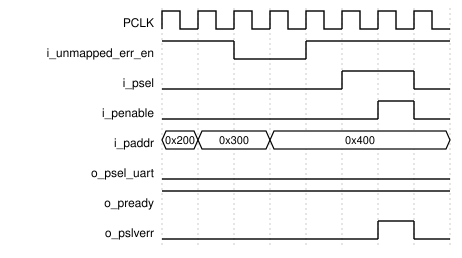 | 2026-11-05 |
| WF-009 | OP-006 write to a slave with Register Outputs only, zero-wait slave | success | i_psel, i_penable, i_paddr, i_pwdata, o_pready, o_psel_uart, o_penable_uart, o_paddr_uart, o_pwdata_uart, i_pready_uart |  | 2026-11-05 |
| WF-010 | OP-006 write to a slave with Register Inputs only, zero-wait slave | success | Same as WF-009 | 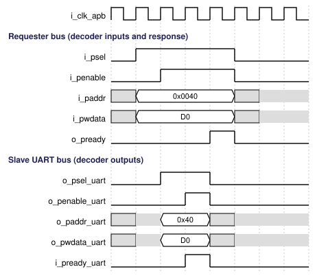 | 2026-11-05 |
| WF-011 | OP-006 write with both options, zero-wait slave | success | Same as WF-009 | 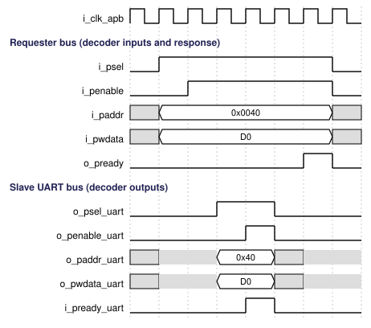 | 2026-11-05 |
| WF-012 | OP-006 access to an unmapped address with both options, pin at 1 | error | i_unmapped_err_en, i_psel, i_penable, i_paddr, o_pready, o_pslverr, o_psel_uart, o_penable_uart | 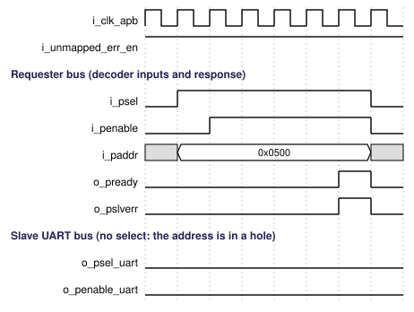 | 2026-11-05 |
| WF-013 | OP-006 write with both options, the slave holds PREADY low for two access cycles | corner | Same as WF-009 | 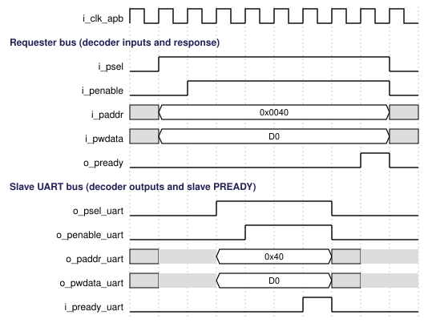 | 2026-11-05 |
| WF-014 | OP-005 write to ROMTAB (0xE014) with no register option; o_paddr_romtab for Address Rebase = 1 (0x04) and 0 (0x14) | success | i_psel, i_penable, i_paddr, o_pready, o_psel_romtab, o_penable_romtab, o_paddr_romtab (both settings), i_pready_romtab | 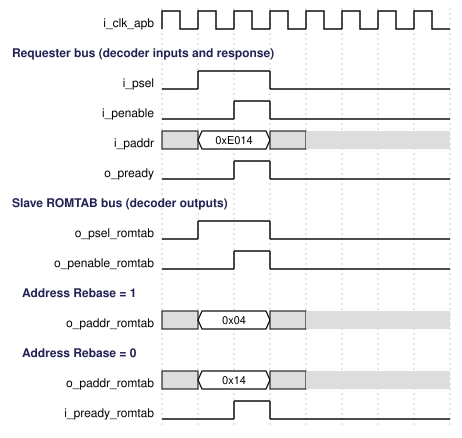 | 2026-11-06 |
| WF-015 | OP-005 and OP-006, same write with Register Outputs only | success | Same as WF-014 |  | 2026-11-06 |
| WF-016 | OP-005 and OP-006, same write with Register Inputs only | success | Same as WF-014 | 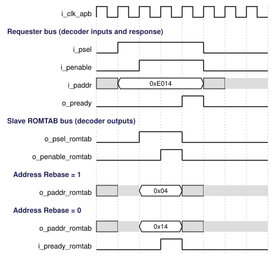 | 2026-11-06 |
| WF-017 | OP-005 and OP-006, same write with both options | success | Same as WF-014 | 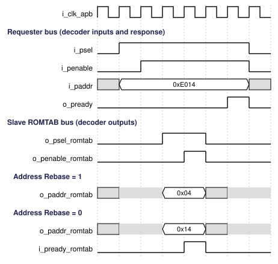 | 2026-11-06 |

WF-014 to WF-017 follow the cycle counts of section 10.4 (the zero-wait slave of WF-009 to WF-011); the rebase value is the same in all four, only the cycle in which it appears moves. At the ports WF-015 and WF-016 are identical: the delay of the two options is the same and differs only in where the flip-flops sit (section 10.4).

Cycle table of an unmapped read with i_unmapped_err_en = 1 and a mapped slave behind (clock edges of PCLK):

| Cycle / event | Input condition | State/action | Output condition |
|---|---|---|---|
| T0 | i_psel = 0 | Idle | All o_psel_k = 0; o_pslverr = 0 |
| T1 (setup) | i_psel = 1, i_penable = 0, i_paddr in a hole, i_pwrite = 0 | No window matches | All o_psel_k = 0; o_pready = 1; o_pslverr = 0 because i_penable = 0 |
| T2 (access) | i_psel = 1, i_penable = 1 | Same address | o_pready = 1; o_prdata = 0; o_pslverr = 1; the requester completes the transfer at the end of T2 |
| T3 | i_psel = 0 or a new setup | Idle or next transfer | o_pslverr returns to 0 |

### 10.4 Arbitration, buffering, and throughput

Cycles of one write to a zero-wait slave, counted from the requester setup cycle T (REQ-PERF-002; waveforms WF-009 to WF-011):

| Register Inputs | Register Outputs | Slave setup cycle | Slave access cycle (PREADY) | Requester PREADY cycle | Cycles from setup to PREADY |
|---|---|---|---|---|---|
| 0 | 0 | T | T + 1 | T + 1 | 2 |
| 1 | 0 | T + 1 | T + 2 | T + 3 | 4 |
| 0 | 1 | T + 1 | T + 2 | T + 3 | 4 |
| 1 | 1 | T + 2 | T + 3 | T + 5 | 6 |

There is no arbitration, buffering or queue: the requester starts one transfer at a time. Because the windows do not overlap, the select is one-hot and no priority between slaves is needed. The throughput is that of the requester and the slaves (2 cycles per transfer without wait states); the decoder adds nothing (REQ-PERF-001).

With an option on the decoder handles one transfer at a time: a transfer takes 2 + 2a + 2b cycles plus the wait states of the slave, so the throughput is one transfer per that many cycles.

What each option costs, in clock cycles of i_clk_apb (a = Register Inputs, b = Register Outputs, zero-wait slave, T = the requester setup cycle, see waveforms WF-009 to WF-011 and WF-014 to WF-017):

| Option | Delay of the slave setup phase (select, address and data valid at the slave) | Delay of the end of the transfer (requester PREADY, PRDATA, PSLVERR) | Cycles from setup to PREADY | Total delay added to the transfer | Where the extra cycles come from |
|---|---|---|---:|---|---|
| None | 0 (same cycle T) | 0 (T + 1) | 2 | 0 | Combinational decoder, no clock |
| Register Inputs | +1 (T + 1) | +2 (T + 3) | 4 | 2 cycles | One cycle to register the requester inputs before the decode; one cycle to register the slave response before it is returned to the requester |
| Register Outputs | +1 (T + 1) | +2 (T + 3) | 4 | 2 cycles | One cycle to register the select, address and data going to the slaves; one cycle to register the response returned to the requester |
| Both | +2 (T + 2) | +4 (T + 5) | 6 | 4 cycles | The sum of the two stages (2 + 2) |

Rules that follow from the table:

- The added delay is a fixed 2 cycles per option for a transfer to a slave and for a transfer to an unmapped address; the wait states of the slave (cycles with i_pready_k low) come on top, one for one, because the slave PREADY pin is not registered (DEC-012).
- A transfer on the requester bus is therefore stretched with wait states (o_pready low during the access phase); the requester needs no change because APB allows any number of wait states.
- The address value a slave sees (Address Rebase 1 or 0) is the same in every combination; it appears in the slave setup cycle shown in the second column and is held until the end of the access phase.
- In the two single-option cases the two options give the same cycle count and the same waveform at the ports; they differ only in where the flip-flops sit: Register Inputs registers every decoder input (the path from the requester ends at a flip-flop), Register Outputs registers every decoder output (the slave pins and the requester response are driven by flip-flops). Both together isolate both sides.
- Throughput: one transfer takes 2 cycles with no option, 4 cycles with one option and 6 cycles with both, plus the wait states of the slave.

### 10.5 Memories and storage

N/A: the decoder has no memory or storage element.

## 11. Register and programming model

**Not required (confirmed by user, 2026-11-05):** the decoder has no software-visible register; the choice between an error and a ready response is made by the input pin i_unmapped_err_en, not by a register.

### 11.1 CSR specification source

**Not required (confirmed by user, 2026-11-05):** no CSR workbook exists, because the IP has no register.

### 11.2 Software sequences

There is no register to program. The sequence below is the normal use of the IP: the integration flow of the generator, followed by the use of the generated decoder. Step IDs and options are the same in the flowchart and in the table (rule R-043).

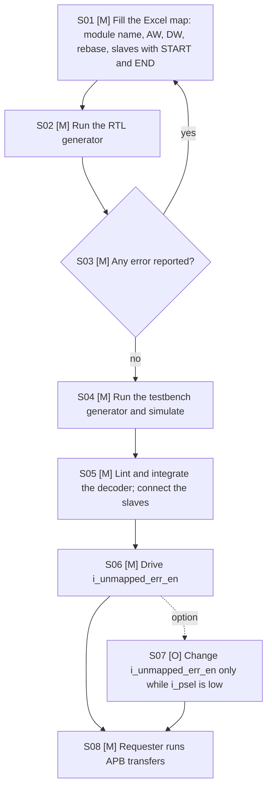

| No. | Step | Option (M/O) | Interface | CSR | Description |
|---|---|---|---|---|---|
| S01 | Fill the Excel map | M | Excel workbook with the sheet APB_DEC | N/A: the decoder has no CSR | Defines the windows and the options (Address Rebase, Register Inputs, Register Outputs); the user enters only START and END, never a width |
| S02 | Run the RTL generator | M | Command line `src/apb_dec_rtl_generator.py` | N/A: no CSR | Validates the map, computes SIZE and W_k, writes RTL, JSON and file list |
| S03 | Check the reported problems | M | Generator output and exit code | N/A: no CSR | An overlap, a window outside the bus or a bad name stops the flow with exit code 1 and no file |
| S04 | Generate the testbench and simulate | M | Command line `src/apb_dec_tb_generator.py`, then the simulator | N/A: no CSR | Self-checking regression of every window edge and the unmapped holes with both pin values |
| S05 | Lint and integrate | M | APB4 requester port and one APB4 port per slave | N/A: no CSR | Connects the decoder between the bridge and the peripherals |
| S06 | Drive the pin i_unmapped_err_en | M | Input pin | N/A: no CSR | 1 gives an error response for an unmapped address, 0 gives ready only; tie it or drive it from an SoC control bit |
| S07 | Change the pin | O | Input pin | N/A: no CSR | Allowed only while i_psel is low (REQ-CLK-001), for example at a bring-up phase change |
| S08 | Run APB transfers | M | APB4 requester port | N/A: no CSR | Mapped transfers reach the slave; unmapped transfers get the response selected in S06 |

### 11.3 CSR connection to the design

**Not required (confirmed by user, 2026-11-05):** no CSR exists, so no field is connected.

### 11.4 APB access behavior of the CSR

**Not required (confirmed by user, 2026-11-05):** no CSR exists. The APB behavior of the decoder itself is in section 6.3.

## 12. Error handling and recovery

| Error ID | Detection condition | Observable response/status | Interrupt | Clear/recovery | Reset behavior |
|---|---|---|---|---|---|
| ERR-001 | Transfer to an unmapped address with i_unmapped_err_en = 1 | o_pready 1 and o_pslverr 1 in the access cycle; o_prdata 0 | None | None needed; the requester sees the error and decides | No state |
| ERR-002 | Transfer to an unmapped address with i_unmapped_err_en = 0 | o_pready 1, o_pslverr 0, o_prdata 0; the miss is not reported | None | None | No state |
| ERR-003 | Slave error (i_pslverr_k high with i_pready_k) | o_pslverr high in the same cycle | None | Slave dependent | No state |
| ERR-004 | Invalid Excel configuration at generation time | Exit code 1, list of problems, no file written | None | Correct the Excel file | Not applicable: tool step |
| ERR-005 | Pin i_unmapped_err_en changes during a transfer | Response of that transfer is not defined; no hang | None | Integrator holds the pin | No state |
| ERR-006 | Reset asserted while a transfer is in progress (an option on) | Every flip-flop returns to idle; the slaves see PSEL low; no PREADY is returned for that transfer | None | The requester is reset in the same event, or restarts the transfer | Reset |

Error precedence: a selected slave is never overridden by the pin. For an unmapped address the pin alone decides. A decode error cannot occur together with a slave error, because the two cases are exclusive. Error responses never abort the transfer: the transfer completes with o_pready high (REF-001 section 3.4: an error is returned together with PREADY).

## 13. Performance, power, and area

| Metric ID | Metric | Target / limit | Conditions | Measurement method | Hard / goal |
|---|---|---|---|---|---|
| PPA-001 | Maximum combinational delay from i_paddr to o_pready, o_prdata and o_pslverr | TBD-002 | Corner and PCLK period of the SoC | STA with the constraints of section 17 | Goal until TBD-002 is closed |
| PPA-002 | Area | TBD-002: roughly N comparator pairs of AW bits and a data multiplexer of N inputs | Library of the SoC | Cell area after synthesis | Goal |
| PPA-003 | Dynamic and leakage power | TBD-002 | SoC activity and corner | Power analysis | Goal |
| PPA-004 | Flip-flop count | Register Inputs: AW + DW + STRB + 6 for the requester signals, plus 1 + DW per slave for read data and error, plus the phase and pulse flops; Register Outputs: per slave W + DW + STRB + 6, plus DW + 3 for the requester side | Per configuration | Count of reg_ signals after synthesis | Goal |
| PERF-001 | Added latency | 0 cycles with both options 0; 2 cycles for each option that is on (REQ-PERF-002) | Any configuration | Simulation, scoreboard cycle count | Hard (REQ-PERF-001, REQ-PERF-002) |

Timing closure is not claimed by RTL synthesis alone. The decoder lies on the path from the requester through the slave response back to the requester, so its delay adds to the APB setup time budget of the SoC.

## 14. RTL implementation contract

### 14.1 Required coding baseline

The VLSIT RTL Design Rules v2 (REF-003) are the mandatory coding authority. The generated files follow them: one module per file with the same name as the file, ANSI ports with `input wire` and `output logic`, no clock or reset because there is no state, `always_comb` with defaults or continuous assignments for the logic, named port connections, derived constants as `localparam logic [31:0] LPARA_...` in the parameter port list, no `casex`, no latch, no simulation delay, no macro, and names of at most 30 characters. The file header holds Project, Author, AI Flow, AI Flow Page, Date and Description.

### 14.2 RTL hierarchy

| Module | Responsibility | Parent / instance | Clock/reset domains | Interface |
|---|---|---|---|---|
| m_vlsit_apbdec | Window match, local address and response selection in one module; plain forwarding wires for penable, pwrite, pwdata, pstrb and pprot | Top (no child module) | None | APB4 requester-side port, N slave-side ports, i_unmapped_err_en |

The generated RTL is one module in one file `{module}.sv` (decision DEC-010). With both options 0 the module has no state; with an option on it has flip-flops written in always_ff blocks with asynchronous reset (their names start with reg_), and the clock and reset ports. In every case it has no instance of another module, so there is no hierarchy below the top. The constants of the windows (`LPARA_{SLAVE}_START`, `LPARA_{SLAVE}_END`) and of the port widths (`LPARA_{SLAVE}_W`) are derived localparams in the parameter port list; a constant is written only when the logic uses it.

### 14.3 Synthesis assumptions

| Item | Value / source |
|---|---|
| Top / source file list | `m_vlsit_apbdec` (one file); `output/filelist.f` written by the generator |
| Frontend version and options | Not fixed: any frontend that accepts REF-003 constructs; verified with Verilator 5.053 and iverilog 12 in this repository |
| Parameters/configuration | None overridable (section 8) |
| Libraries/corners | Not fixed by this IP (TBD-002) |
| Memory flow | Not applicable: no memory |
| Lint rule configuration | Verilator `--lint-only -Wall` and the rule check of the skill vlsit-rtl-generator; Synopsys VC Static scripts in `lint/vc_static` |

## 15. Verification specification

### 15.1 Scope and strategy

Levels: generator unit tests, block simulation of every configuration with the generated testbench and the bus functional models of `sim/lib`, protocol assertions, formal equivalence of the decode against a reference model, lint and the rule check. Simulations use fixed seeds when random traffic is added; the generated directed test needs no seed. The configurations are CFG-EX, CFG-RAW, CFG-MIN and CFG-MAX. The golden reference is a Python model of the decode written from this specification (never from the RTL).

Implementation status (2026-11-05). The generators, the testbench generator and the tests of this revision are in the repository; the table lists where each part of the plan runs and the result of the run that was made when the code was written (iverilog 12, Verilator 5.053, Python 3.12).

| Plan item | Implemented by | Result |
|---|---|---|
| TEST-001 to TEST-008 (decoder behavior) | The generated testbench: reference-model monitor in every cycle, directed edge, neighbor and hole checks with the pin at 1 and at 0, byte lanes, slave wait states, a slave error, random traffic with the pin changing between transfers | 288 of 288 simulations PASS: 12 memory maps x Data Width 8, 16, 32 x Address Rebase 0, 1 x Register Inputs 0, 1 x Register Outputs 0, 1 (`tests/run_matrix.py`); between 10 000 and 660 000 checks each; the protocol checker on every bus and the scoreboard report no violation |
| TEST-002, TEST-009, TEST-010, TEST-012, TEST-015 (generator) | `tests/test_generator.py` and `tests/test_register_options.py`: 78 tests of the validation, the workbook format with the GUIDELINE sheet, the computed widths, the warnings, the files, the JSON, the limits (1 and 64 slaves, 1-bit and 32-bit buses, 30-character module name, 18-character slave name) and the register options (ports, flip-flop placement, option values, documented latency) | 78 of 78 PASS; line coverage of the generator scripts 97.9 % and 98.0 % (`tests/cov_python.py`) |
| TEST-011 (rule check, lint) | `tests/lint_matrix.py`: Verilator `-Wall` and the rule checker of the skill vlsit-rtl-generator on the RTL of all 72 combinations | 288 of 288 clean, with no Verilator warning |
| TEST-013 (mutation) | 13 mutations of the generated RTL (compare off by one, wrong rebase, pin ignored or inverted, PSLVERR not gated, wrong data or ready for a hole, wrong slave response, PPROT or PSTRB not forwarded, select swapped or not gated) | 13 of 13 detected for the combinational decoder, and 10 of 10 for the registered decoder (TEST-018 and the input-only and output-only faults) |
| COV-001 to COV-003 (RTL coverage) | Verilator `--coverage-line --coverage-toggle` on 25 combinations (`tests/cov_matrix.py`) | Over all 25 runs (13 combinational, 12 with a register option) line 100 %, branch 97.1 %, toggle 97.8 %; every run at least 80 % on each type. The combinational RTL has no if or else, so Verilator reports branch points only for the registered variants. The default arm of the response case is excluded when the windows cover the whole space, because it cannot be reached there |
| SVA-001 to SVA-008 | Checked by the monitor of the generated testbench as run-time checks (select one-hot, forwarding, response, PSLVERR gating, local address); stand-alone bound SVA modules and the formal equivalence of section 15.4 are not written yet | Open |

### 15.2 Requirement-based test plan

| Test ID | Requirements | Scenario / stimulus | Expected result | Test type | Configuration |
|---|---|---|---|---|---|
| TEST-001 | REQ-FUNC-001, REQ-FUNC-002 | Read and write at the first and last address of every window and at the addresses just below the start and just above the end | Only the owner is selected inside the window, none outside | Directed | CFG-EX |
| TEST-002 | REQ-FUNC-003, REQ-GEN-003 | Generate windows of 1, 2, 3, 24, 4096 and 6144 bytes | Widths 1, 1, 2, 5, 12 and 13; JSON size_bytes agrees | Generator unit test | CFG-EX, CFG-MIN |
| TEST-003 | REQ-FUNC-004 | Write each offset of the window of an unaligned slave, rebase 1 then 0 | o_paddr_k is the offset (rebase 1) or the raw low bits (rebase 0) | Directed | CFG-EX, CFG-RAW |
| TEST-004 | REQ-FUNC-005, REQ-IF-001 | Drive random PWDATA, PSTRB, PPROT and PWRITE | Every slave port equals the input, selected or not | Random with reference model | CFG-EX |
| TEST-005 | REQ-FUNC-006, REQ-ERR-003 | Slave BFM with 0, 1 and 3 wait states, and with an error response | o_pready, o_prdata and o_pslverr follow the slave in the same cycle | Directed | CFG-EX |
| TEST-006 | REQ-FUNC-007, REQ-FUNC-008, REQ-ERR-001, REQ-ERR-002 | Unmapped read and write in every hole and above the last window, pin 1 and pin 0 | pin 1: PSLVERR 1; pin 0: PSLVERR 0; PREADY 1 and PRDATA 0 in both; no select | Directed | CFG-EX, CFG-RAW |
| TEST-007 | REQ-FUNC-009, REQ-PERF-001, REQ-RESET-001 | Compare outputs with a combinational model at every cycle during random traffic | Equal in every cycle, no extra latency | Random with reference model | CFG-EX |
| TEST-008 | REQ-CLK-001 | Change the pin while i_psel is low, then run a transfer | The response uses the new value; no hang | Directed | CFG-EX |
| TEST-009 | REQ-GEN-001, REQ-GEN-002, REQ-GEN-004 | Excel files with: START greater than END, END beyond 2^AW - 1, overlap, bad names (spaces, 19 characters, case clash), missing sheet, old schema | Exit code 1, every problem listed, no output file written | Generator unit test | None |
| TEST-010 | REQ-GEN-005, REQ-GEN-006, REQ-GEN-007 | JSON fields; rebase 0 with ROMTAB; marker file and file list | Fields present; one warning; files exist | Generator unit test | CFG-EX, CFG-RAW |
| TEST-011 | REQ-RTL-001, REQ-RTL-002 | Rule check and lint of the generated files of every configuration | No ERROR finding, no latch | Static | All |
| TEST-012 | REQ-IF-002, REQ-IF-003 | Generate with AW 1 and 32, DW 8, 16 and 32, 1 and 64 slaves | Port widths and names as specified, each at most 30 characters | Generator unit test | CFG-MIN, CFG-MAX |
| TEST-014 | REQ-GEN-008 | Open every delivered workbook and check font, size, bold titles and headers, palette, wrapping, column widths and row heights; parse a styled workbook | Every check holds; the generator reads the styled file | Workbook style test | None |
| TEST-015 | REQ-FUNC-010, REQ-FUNC-011, REQ-IF-004, REQ-GEN-009 | Generate every combination of the two options; inspect the ports and the placement of the flip-flops; give option values 2 and text | Ports and flip-flops as specified; the wrong values are errors | Generator unit test, inspection | CFG-REG-IN, CFG-REG-OUT, CFG-REG-BOTH |
| TEST-016 | REQ-FUNC-012, REQ-FUNC-013, REQ-FUNC-014, REQ-FUNC-005 | Simulate every combination with the protocol checker on every bus and the scoreboard: mapped and unmapped transfers, slave wait states, a slave error, random traffic with the pin changing | No violation; every transfer as the reference model | Simulation | CFG-REG-IN, CFG-REG-OUT, CFG-REG-BOTH |
| TEST-017 | REQ-PERF-002 | Count the cycles of unmapped transfers in the scoreboard | 2, 4, 4 and 6 cycles | Simulation | CFG-EX, CFG-REG-IN, CFG-REG-OUT, CFG-REG-BOTH |
| TEST-018 | REQ-RESET-001, REQ-VER-003 | Eight faults of the registered decoder (a slave select held one cycle too long, a response pulse that is not aligned with the data, PSLVERR without PREADY, PREADY one cycle early, a skipped setup phase, an access that never ends, write data and read data lost) | Every fault detected by the checkers or the scoreboard | Mutation | CFG-REG-IN, CFG-REG-OUT, CFG-REG-BOTH |
| TEST-013 | REQ-VER-001, REQ-VER-002 | Run the generated testbench on a correct decoder and on a decoder with one deliberate fault (off-by-one END) | PASS on the first, FAIL with exit code 1 on the second | Mutation | CFG-EX |

Cover reset behavior (not applicable: there is no reset), parameter extremes (CFG-MIN and CFG-MAX), simultaneous events (none: one requester), ordering (none), errors (TEST-006, TEST-009), invalid inputs (TEST-009), boundaries (TEST-001) and low-power transitions (not applicable: no power state).

### 15.3 Assertions and coverage

SVA and coverage code stay in the verification source set and are bound to the decoder; they are not part of the synthesized RTL.

| Property / coverage ID | Intent | Requirements | Checker / source set | Acceptance criterion |
|---|---|---|---|---|
| SVA-001 | At most one o_psel_k is high | REQ-FUNC-002 | Verification | Never fails; fires with a selected transfer |
| SVA-002 | o_psel_k is high only when i_psel is high and the address is inside the window | REQ-FUNC-001, REQ-FUNC-002 | Verification | Never fails |
| SVA-003 | When all o_psel_k are low and i_psel and i_penable are high, o_pready is 1 and o_prdata is 0 | REQ-FUNC-007 | Verification | Never fails |
| SVA-004 | When all o_psel_k are low, o_pslverr equals i_psel and i_penable and i_unmapped_err_en | REQ-FUNC-007, REQ-FUNC-008 | Verification | Never fails |
| SVA-005 | o_pslverr is low when i_psel, i_penable or o_pready is low | REQ-FUNC-006 | Verification | Never fails |
| SVA-006 | o_penable_k, o_pwrite_k, o_pwdata_k, o_pstrb_k and o_pprot_k equal the inputs | REQ-FUNC-005 | Verification | Never fails |
| SVA-007 | While i_psel is high, i_unmapped_err_en is stable | REQ-CLK-001 | Verification, assume at the integration | Never fails; used as an assumption in formal |
| SVA-008 | o_paddr_k equals the offset (rebase) or the raw low bits for the selected slave | REQ-FUNC-004 | Verification | Never fails |
| SVA-009 | PENABLE of a slave is never high without its PSEL | REQ-FUNC-005, REQ-FUNC-012 | Verification (protocol checker rule R1) | Never fails |
| SVA-010 | A slave sees no access cycle after the cycle where it asserted PREADY | REQ-FUNC-012, REQ-FUNC-014 | Verification (protocol checker rule R5) | Never fails |
| SVA-011 | The requester sees PREADY in exactly one cycle per transfer, and PSLVERR only with it | REQ-FUNC-013 | Verification (scoreboard and rule R7) | Never fails |
| COV-001 | Every slave is selected; every window edge and every neighbor address is seen | REQ-FUNC-001 | Verification | All bins hit |
| COV-002 | Unmapped read and write with the pin 0 and 1, in every hole | REQ-FUNC-007 | Verification | All bins hit |
| COV-003 | Slave error, slave wait state, back-to-back transfers to different slaves | REQ-FUNC-006 | Verification | All bins hit |

X policy: inputs are driven with known values after the first setup; an unknown on i_paddr with i_psel high is a testbench error. There is no resetless payload in the decoder.

### 15.4 Formal, CDC, and RDC

| Analysis | Scope | Assumptions / constraints | Evaluation method |
|---|---|---|---|
| Formal | Equivalence of the select vector and of o_paddr_k against the reference model for AW up to 16 bits and for CFG-EX | i_unmapped_err_en stable while i_psel is high | Equivalence check; assertion proof of SVA-001 to SVA-006 |
| CDC / RDC | N/A: the decoder has one domain and no flop | None | Not applicable |

## 16. DFT and testability

With both options 0 the decoder is purely combinational (N/A: no flop, memory or clock), so it has no scan, MBIST or test-clock requirement; its logic is tested by the scan of the surrounding flops and by ATPG through its combinational cone. With an option on its flip-flops are plain D flip-flops with asynchronous reset and are scan cells of the SoC chains; there is no latch and no clock gating (MBIST: N/A: no memory). The pin i_unmapped_err_en has no test control.

| Topic | Requirement / decision |
|---|---|
| Scan architecture and scan eligibility | With both options 0: N/A: no sequential cell. With an option on: every flip-flop is scan-eligible (D flip-flop, asynchronous reset, no latch) |
| Scan/test clocks, controls, reset behavior | With both options 0: N/A: no clock and no reset. With an option on: i_clk_apb is the scan clock and the integrator makes i_rst_n_apb controllable in test mode (REF-003 RST-04) |
| Test-mode entry/exit and safe state | N/A: the outputs follow the inputs in every mode |
| MBIST, memory repair, LBIST | N/A: no memory |
| Test access, wrappers, test points | None |
| Clock-gating test enable | N/A: no clock gating |
| ATPG constraints and exclusions | None; i_unmapped_err_en is a normal controllable input |
| DFT insertion architecture and generated test artifacts | None |

## 17. Physical design and timing integration

### 17.1 Timing constraints and budgets

The decoder has no clock port. All ports are timed against the clock PCLK of the connected interconnect (CLK-APB), and the paths through the decoder are purely combinational. The SoC integrator supplies the SDC; the IP delivers the budget table below, whose values are set in TBD-002.

#### 17.1.1 Clock and analysis scenarios

| Clock ID | Port / source object | Primary/generated and master | Period, waveform, phase / ratio | Latency / uncertainty / transition | Clock group / mode | Constraint source |
|---|---|---|---|---|---|---|
| CLK-APB | Port i_clk_apb with an option on; none otherwise (PCLK of the SoC) | Primary at the SoC | Set by the SoC | Set by the SoC | One group | SoC SDC |

#### 17.1.2 Interface timing budgets

| Interface / port group | Direction | Reference clock | External min / max delay | Input transition / output load | IP timing budget | Mode / condition | Constraint source |
|---|---|---|---|---|---|---|---|
| i_paddr, i_psel, i_penable, i_pwrite, i_pwdata, i_pstrb, i_pprot | Input | PCLK | Set by the SoC | Set by the SoC | TBD-002 | All | SoC SDC |
| i_pready_k, i_pslverr_k, i_prdata_k | Input | PCLK | Set by the SoC | Set by the SoC | TBD-002 | All | SoC SDC |
| o_pready, o_prdata, o_pslverr, o_psel_k, o_paddr_k, o_penable_k, o_pwrite_k, o_pwdata_k, o_pstrb_k, o_pprot_k | Output | PCLK | Set by the SoC | Set by the SoC | TBD-002 | All | SoC SDC |
| i_unmapped_err_en | Input | PCLK, or static | Constant while i_psel is high | Set by the SoC | Same as the other inputs when driven from a flop; not applicable when tied | Quasi-static | SoC SDC |

The slave-to-requester path (i_pready_k to o_pready, through the decoder and the requester logic) is the longest decoder path of the APB loop; the SoC allocates its budget.

With an option on, the input paths end at the input flip-flops and the output paths start at the output flip-flops. The exceptions to this are the slave PREADY pins, which also feed the end-of-access logic (about two gate levels to the phase flip-flops), and, with Register Inputs = 0, the requester inputs, which feed the trigger and the window match before the phase flip-flops.

#### 17.1.3 Timing exception inventory

| Exception ID | Type / SDC command | From | Through | To | Value and setup/hold/min/max meaning | Mode / condition | Technical rationale |
|---|---|---|---|---|---|---|---|
| EXC-001 | set_false_path, only when the pin comes from a static strap or a constant | Port i_unmapped_err_en | None | Outputs o_pslverr | Removes the timing check of a signal that never changes while i_psel is high | Pin strapped | REQ-CLK-001 makes the pin quasi-static in a transfer; apply only if it is tied or changes only at a safe point |

No other exception is used. When the pin is driven from a PCLK flop, no exception is applied and the pin is a normal input path.

### 17.2 Physical assumptions

| Topic | Requirement / assumption |
|---|---|
| Hard/memory macros and views | None |
| Floorplan, placement region, pin placement | Place the decoder near the APB bridge; the address compare is wide (AW bits) |
| Utilization/congestion target | Not constrained: small combinational logic |
| Power intent, clock/reset trees | None: no clock, no reset |
| High-fanout controls, physical-only cells | i_paddr, i_psel and i_penable drive every slave-side port group; buffering is by the flow |
| ECO/spare cells | By the SoC flow |
| Extraction and timing-analysis corners | Set by the SoC |
| Delivery form: RTL/netlist/hardened layout | Soft RTL generated by the tool |

## 18. Security, safety, and reliability

| Topic | Requirement / rationale | Verification method / expected behavior |
|---|---|---|
| Security boundary and threat assumptions | N/A: the decoder is not a security boundary | Not applicable |
| Access control / privilege | PPROT is forwarded to the slaves unchanged; the decoder does not allow or deny an access (REQ-FUNC-005) | TEST-004 |
| Secure clearing / zeroization | N/A: no storage | Not applicable |
| Information leakage / side channels | An unmapped read returns 0 and never exposes the data of a slave (REQ-FUNC-007) | TEST-006 |
| ECC/parity and fault detection | N/A: no parity protection in the APB4 profile | Not applicable |
| Safety goal / integrity level | N/A: no safety goal is defined for this IP | Not applicable |
| Diagnostics, fail-safe state, recovery | With the pin at 1 a wild access is reported by PSLVERR; no recovery action in the decoder | TEST-006 |

## 19. Requirement-to-verification traceability

| Requirement ID | RTL module/location | Test/property | Verification method / analysis | Configuration |
|---|---|---|---|---|
| REQ-FUNC-001 | m_vlsit_apbdec | TEST-001, SVA-002, COV-001 | Simulation, formal | CFG-EX |
| REQ-FUNC-002 | m_vlsit_apbdec | TEST-001, SVA-001 | Simulation, formal | CFG-EX |
| REQ-FUNC-003 | Generator; m_vlsit_apbdec | TEST-002 | Generator test | CFG-EX, CFG-MIN |
| REQ-FUNC-004 | m_vlsit_apbdec | TEST-003, SVA-008 | Simulation | CFG-EX, CFG-RAW |
| REQ-FUNC-005 | m_vlsit_apbdec | TEST-004, SVA-006 | Simulation | CFG-EX |
| REQ-FUNC-006 | m_vlsit_apbdec | TEST-005, SVA-005, COV-003 | Simulation | CFG-EX |
| REQ-FUNC-007 | m_vlsit_apbdec | TEST-006, SVA-003, SVA-004, COV-002 | Simulation | CFG-EX, CFG-RAW |
| REQ-FUNC-008 | m_vlsit_apbdec | TEST-006, SVA-004 | Simulation | CFG-EX |
| REQ-FUNC-009 | All modules | TEST-007 | Lint, inspection, simulation | All |
| REQ-FUNC-010 | m_vlsit_apbdec (input stage) | TEST-015 | Inspection, generator test | CFG-REG-IN, CFG-REG-BOTH |
| REQ-FUNC-011 | m_vlsit_apbdec (output stage) | TEST-015 | Inspection, generator test | CFG-REG-OUT, CFG-REG-BOTH |
| REQ-FUNC-012 | m_vlsit_apbdec (phase state machine) | TEST-016, SVA-009, SVA-010 | Protocol checker, scoreboard | CFG-REG-IN, CFG-REG-OUT, CFG-REG-BOTH |
| REQ-FUNC-013 | m_vlsit_apbdec (response pulse) | TEST-016, SVA-011 | Protocol checker, scoreboard | CFG-REG-IN, CFG-REG-OUT, CFG-REG-BOTH |
| REQ-FUNC-014 | m_vlsit_apbdec (end-of-access logic) | TEST-016, SVA-010 | Protocol checker | CFG-REG-IN, CFG-REG-OUT, CFG-REG-BOTH |
| REQ-IF-001 | All modules | TEST-004 | Protocol checker, inspection | CFG-EX |
| REQ-IF-002 | Generator; top | TEST-012 | Generator test | CFG-MIN, CFG-MAX |
| REQ-IF-003 | Generator; top | TEST-012 | Generator test, lint | CFG-MIN, CFG-MAX |
| REQ-IF-004 | Generator; top ports | TEST-015 | Generator test, lint | CFG-REG-IN, CFG-REG-OUT, CFG-REG-BOTH |
| REQ-CLK-001 | Top port i_unmapped_err_en | TEST-008, SVA-007 | Simulation, SDC review | CFG-EX |
| REQ-RESET-001 | m_vlsit_apbdec | TEST-007, TEST-016, TEST-018 | Inspection, lint, simulation, mutation | All |
| REQ-GEN-001 | Generator | TEST-009 | Generator test | None |
| REQ-GEN-002 | Generator | TEST-009 | Generator test | None |
| REQ-GEN-003 | Generator | TEST-002 | Generator test | CFG-EX |
| REQ-GEN-004 | Generator | TEST-009 | Generator test | None |
| REQ-GEN-005 | Generator | TEST-010 | Generator test | CFG-EX |
| REQ-GEN-006 | Generator | TEST-010 | Generator test | CFG-RAW |
| REQ-GEN-007 | Generator | TEST-010 | Generator test | CFG-EX |
| REQ-GEN-009 | Generator | TEST-015 | Generator test | CFG-REG-IN, CFG-REG-OUT, CFG-REG-BOTH |
| REQ-ERR-001 | m_vlsit_apbdec | TEST-006, SVA-004 | Simulation | CFG-EX |
| REQ-ERR-002 | m_vlsit_apbdec | TEST-006, SVA-003, SVA-004 | Simulation | CFG-EX |
| REQ-ERR-003 | m_vlsit_apbdec | TEST-005 | Simulation | CFG-EX |
| REQ-PERF-001 | All modules | TEST-007 | Simulation | All |
| REQ-PERF-002 | m_vlsit_apbdec | TEST-017 | Scoreboard cycle count | CFG-EX, CFG-REG-IN, CFG-REG-OUT, CFG-REG-BOTH |
| REQ-RTL-001 | All modules | TEST-011 | Rule check, lint | All |
| REQ-RTL-002 | m_vlsit_apbdec | TEST-011 | Inspection, rule check | All |
| REQ-GEN-008 | Workbook builder (tests/xlsx_style.py) | TEST-014 | Workbook style test | None |
| REQ-VER-001 | Testbench generator | TEST-013 | Generator test, mutation | CFG-EX |
| REQ-VER-002 | Testbench generator | TEST-001, TEST-013 | Simulation | CFG-EX |
| REQ-VER-003 | Testbench generator | TEST-016, TEST-018 | Simulation, mutation | All |

## 20. Assumptions, dependencies, and decisions

| ID | Type | Assumption / dependency / unresolved decision | Technical impact / version / configuration | Resolution / status |
|---|---|---|---|---|
| DEC-001 | Decision | The default naming rule of the skill vlsit-rtl-generator applies (user, 2026-11-05) | Every name of this document and of the generated RTL | Closed |
| DEC-002 | Decision | The unmapped-response pin is named i_unmapped_err_en: the user typed i_unmap_err_en, and NAM-08 writes the word "unmapped" in full because it is not in the abbreviation table | Port name; testbench; documentation | Closed; confirmed by the user 2026-11-06 |
| DEC-003 | Decision | The slave port width is clog2(END - START + 1) with a minimum of 1, with the Address Rebase option kept (user, 2026-11-05) | REQ-FUNC-003, REQ-FUNC-004, REQ-GEN-003 | Closed |
| DEC-004 | Decision | The unmapped response is selected by the level input i_unmapped_err_en: 1 = error, 0 = ready only. The pin is combinational, has no clock, and is stable while i_psel is high (user, 2026-11-05) | REQ-FUNC-007, REQ-FUNC-008, REQ-CLK-001 | Closed |
| DEC-005 | Decision | The Excel slave table uses START ADDRESS and END ADDRESS as the inputs; SIZE and ADDRESS WIDTH are computed; the old OFFSET and ADDRESS WIDTH inputs are not accepted (user, 2026-11-05) | REQ-GEN-001, REQ-GEN-003, REQ-GEN-004 | Closed |
| DEC-006 | Decision | APB4 with PPROT forwarded to every slave (user, 2026-11-05) | REQ-IF-001, REQ-FUNC-005, port o_pprot_k | Closed |
| DEC-007 | Decision | Overlapping windows, START greater than END, and a window beyond the master address space are errors (user, 2026-11-05) | REQ-GEN-002, INV-004 | Closed |
| DEC-008 | Decision | o_pslverr is gated by i_psel, i_penable and o_pready for both mapped and unmapped transfers (REF-001 section 3.4 recommendation) | REQ-FUNC-006, REQ-FUNC-007, INV-003; differs from revision 0.1, which passed the slave value without gating | Closed; confirmed by the user 2026-11-06 |
| DEC-010 | Decision | The generated RTL is one module in one file: the former split into the modules sel, addr and resp is removed (user, 2026-11-05) | REQ-RTL-002, section 5, section 14.2; the generator writes one `.sv` file; with no instance in the module the top is also the only leaf | Closed |
| DEC-011 | Decision | Register Inputs and Register Outputs: flip-flops on all inputs and on all outputs, chosen separately in the Excel file; the APB protocol must hold in every combination (user, 2026-11-05) | REQ-FUNC-010 to REQ-FUNC-014, REQ-PERF-002, REQ-IF-004, REQ-RESET-001, REQ-GEN-009; the decoder becomes clocked when an option is on | Closed |
| DEC-012 | Decision | The slave PREADY inputs and i_unmapped_err_en are not registered by Register Inputs: a registered PREADY would show a slave an extra access cycle after it completed (REF-001 section 4.1), so the end of the access uses the pin; the read data and error inputs are registered | REQ-FUNC-010, REQ-FUNC-014 | Closed; confirmed by the user 2026-11-06 |
| DEC-013 | Decision | o_penable_k is gated with the select of slave k in every configuration (revision 0.2 forwarded i_penable to every slave); found by the protocol checker as PENABLE without PSEL | REQ-FUNC-005, REQ-FUNC-012 | Closed; confirmed by the user 2026-11-06 |
| DEC-009 | Decision | The generated testbench is self-checking and returns a failing exit code on any failure | REQ-VER-001, REQ-VER-002 | Closed (inherited from revision 0.1, extended) |
| ASM-001 | Assumption | The applications of section 1.4 were proposed from the repository example, because the user answered TBD | Section 1.4 and the typical values used in tests | Closed; confirmed by the user 2026-11-06 |
| ASM-002 | Assumption | At most 64 slaves per decoder; the slave name has at most 18 characters so that every name derived from it stays at most 30 characters (o_penable_ and LPARA_..._START add 10 and 12 characters) | REQ-GEN-002, CFG-MAX | Open: limit chosen by the author |
| ASM-004 | Assumption | A row "PSLVERR on Unmapped Access" in an old Excel file is ignored with a warning, because the pin replaces it | REQ-GEN-004 | Open |
| ASM-005 | Assumption | A window of 1 byte uses a 1-bit address port, never a 0-bit port | REQ-FUNC-003 | Open |
| ASM-006 | Assumption | The clock and reset ports are named i_clk_apb and i_rst_n_apb (domain apb) | REQ-IF-004 | Open |
| ASM-007 | Assumption | The requester never aborts a transfer: it waits for PREADY (APB4 has no abort); a reset aborts everything | REQ-FUNC-013, ERR-006 | Closed; confirmed by the user 2026-11-06 |
| TBD-001 | TBD | Real applications of the features (section 1.4); the user answered TBD | Needed to size test corners (slave count, widths) and to rank the features | Open: user input |
| TBD-002 | TBD | Timing, area and power targets of the decoder (section 13 and 17.1.2) | Without them the IP cannot be signed off for timing; the combinational path adds to the APB loop | Open: set by the SoC project |
| DEP-001 | Dependency | An APB4 requester that complies with REF-001 section 4.1, and APB4 slaves | The decoder relies on stable PADDR and attributes during a transfer | Open |
| DEP-002 | Dependency | Python 3 with openpyxl for the generator; Verilator or iverilog for simulation | Tool flow | Open |

## 21. Glossary

| Term / acronym | Definition |
|---|---|
| APB | Advanced Peripheral Bus of AMBA |
| Completer | The APB side that answers a transfer (the peripheral; the decoder acts as one for the requester) |
| Requester | The APB side that starts a transfer (the bridge; the decoder acts as one for every slave) |
| Window | The closed interval of byte addresses START to END that belongs to one slave |
| Unmapped address | An address inside none of the windows |
| Rebase | Subtraction of the start address so that the slave sees an offset that begins at 0 |
| W | Width of the address port of a slave, clog2 of the window size with a minimum of 1 |
| clog2 | Ceiling of the base-2 logarithm |
| Register option | Register Inputs or Register Outputs: flip-flops on all inputs or on all outputs of the decoder |
| Trigger | The cycle in which the decoder sees the requester setup phase while it is idle and starts a transfer |
| PSLVERR | APB transfer error signal |

## 22. References used to shape this template

1. Arm, AMBA APB Protocol Specification, IHI 0024 Issue D (ID041221), converted file `vlsit_apb_amba_apb_ihi0024d` of the skill vlsit-asic-ip-microspec: sections 2.1, 3.1 to 3.5, 4.1 and A.1.
2. VLSIT RTL Design Rules v2, VLSIT_RTL_Design_Rule.md: naming, parameters, hierarchy and the rule check.
3. Repository `nguyenquanicd/APB-DEC-Generator`, revision 0.1 files `apb_dec_rtl_generator.py`, `apb_dec_tb_generator.py`, `APB_DEC_Example.xlsx` and `BUG_REPORT.md`.
